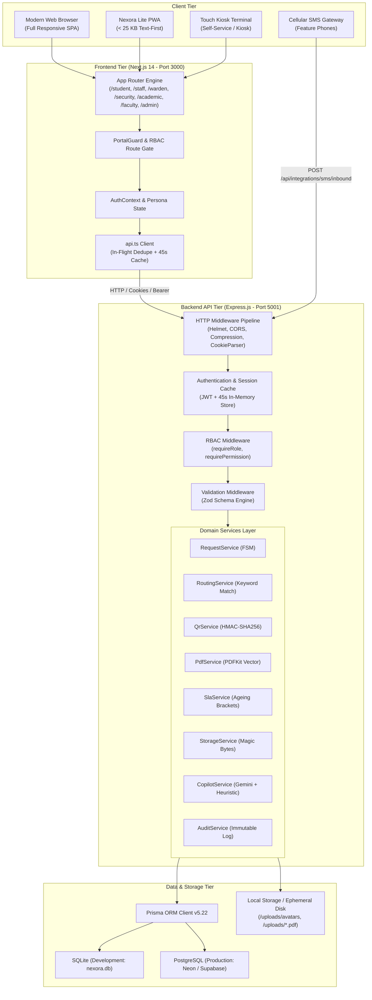
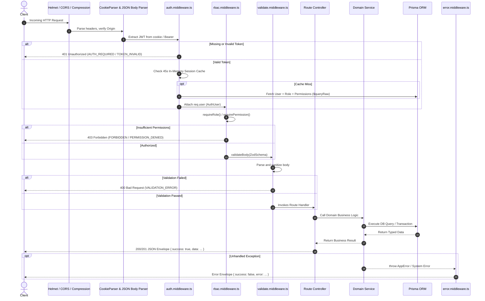
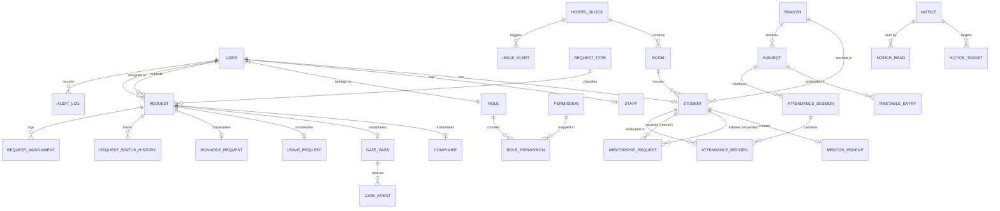
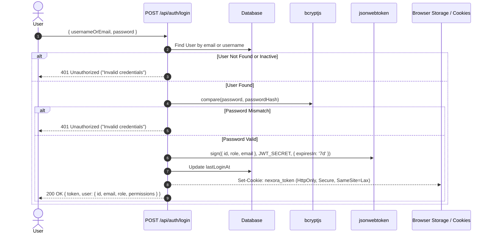
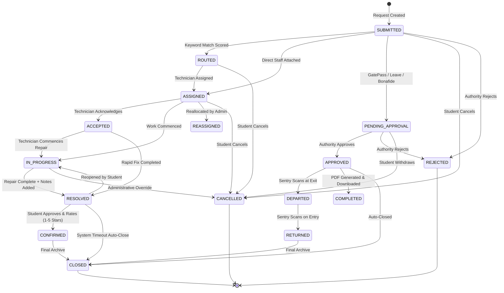
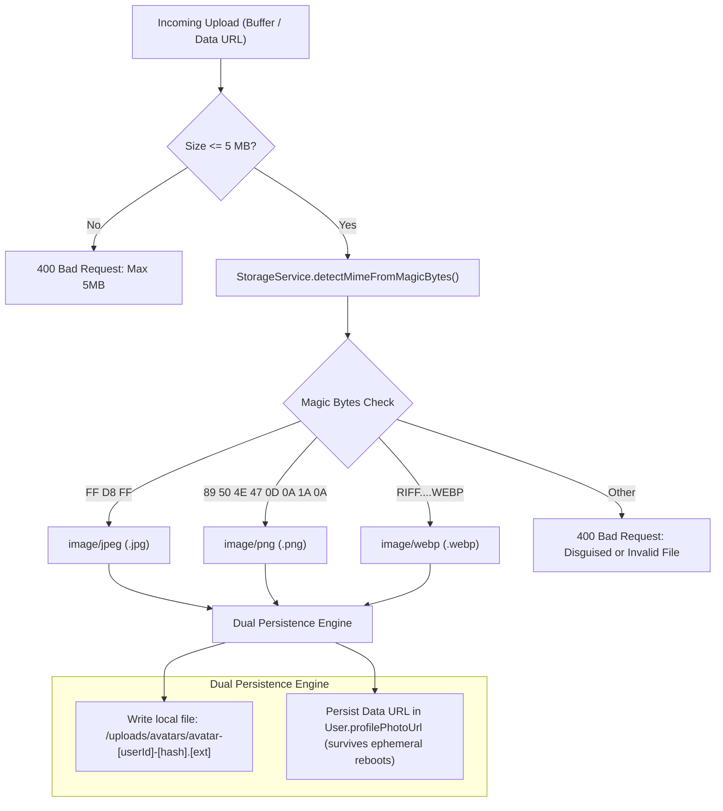

# Nexora Campus — System Architecture & Technical Design Document

> **Architecture Reference Specification**  
> Document Version: 4.0.0  
> Target Platform: Node.js 20+ | Next.js 14 App Router | Express.js 4 | Prisma 5.22  
> System Topology: Decoupled Modular Monolith with RESTful Contract Boundary

---

## Table of Contents

1. [Architecture Overview](#1-architecture-overview)
2. [Architecture Principles](#2-architecture-principles)
3. [High-Level System Topology](#3-high-level-system-topology)
4. [Frontend Architecture](#4-frontend-architecture)
5. [Backend Architecture & Request Lifecycle](#5-backend-architecture--request-lifecycle)
6. [Database Architecture & Entity Relationships](#6-database-architecture--entity-relationships)
7. [Authentication Architecture](#7-authentication-architecture)
8. [Authorization Architecture & RBAC Matrix](#8-authorization-architecture--rbac-matrix)
9. [API Architecture & Response Protocol](#9-api-architecture--response-protocol)
10. [Core Domain Workflows & Finite State Machines](#10-core-domain-workflows--finite-state-machines)
11. [Cryptographic QR & Verification Subsystem](#11-cryptographic-qr--verification-subsystem)
12. [Binary File Storage & Image Sanitization Architecture](#12-binary-file-storage--image-sanitization-architecture)
13. [Immutable Audit Logging Architecture](#13-immutable-audit-logging-architecture)
14. [Exception Handling & Resiliency Model](#14-exception-handling--resiliency-model)
15. [Security Threat Modeling & Countermeasure Audit](#15-security-threat-modeling--countermeasure-audit)
16. [Scalability & Performance Analysis](#16-scalability--performance-analysis)
17. [Deployment & Infrastructure Topography](#17-deployment--infrastructure-topography)
18. [Observability & Health Monitoring](#18-observability--health-monitoring)
19. [Technical Debt Analysis](#19-technical-debt-analysis)
20. [Architectural Recommendations](#20-architectural-recommendations)

---

## 1. Architecture Overview

Nexora Campus is engineered as an event-driven **Modular Monolith** organized within an npm workspace monorepo. The system decouples client presentation from the core business engine:

```text
Nexora Monorepo
 ├── frontend/  --> Next.js 14 App Router (Port 3000)
 └── backend/   --> Express.js TypeScript Service (Port 5001)
```

The platform unifies student requests, facility maintenance, gate perimeter security, academic operations, faculty attendance, and administrative oversight through a shared relational data model. Rather than deploying fragmented microservices that introduce distributed transaction overhead, Nexora encapsulates discrete domain modules inside a single transactional backend process with strict service layer boundaries.

---

## 2. Architecture Principles

1. **Separation of Presentation and Operations**:
   - The frontend acts strictly as a consumer of backend REST APIs. No direct database access or Prisma client imports exist within the frontend codebase.
2. **Deterministic Domain Routing**:
   - Automated ticket dispatching avoids non-deterministic heuristics; it relies on structured scoring against database-backed keyword definitions (`RoutingRule`) to ensure sub-millisecond assignment.
3. **Finite State Machine (FSM) Governance**:
   - Every request adheres to a strictly defined state transition graph. Illegal state transitions are rejected by domain validation before database mutations occur.
4. **Zero-Trust Perimeter Verification**:
   - Gate passes do not rely on simple sequential IDs or unverified database lookups; passes generate an HMAC-SHA256 cryptographic digest verified by sentry terminals.
5. **Fail-Safe Low-Bandwidth Redundancy**:
   - To accommodate spotty campus cellular networks, the platform provides an ultra-lightweight ($< 25\text{ KB}$) PWA interface (`/lite`), hardware touch kiosk terminals (`/kiosk`), and an inbound SMS gateway.
6. **Immutable Accountability**:
   - State mutations across administrative, security, and maintenance operations generate append-only audit entries storing actor ID, action code, IP address, user agent, and before-and-after JSON snapshots.

---

## 3. High-Level System Topology



---

## 4. Frontend Architecture

### 4.1 Next.js 14 App Router Hierarchy
The frontend relies on Next.js 14 nested layouts:
- `app/layout.tsx`: Root layout providing font configurations, CSS variables, `ThemeProvider`, and `AuthProvider`.
- `app/page.tsx`: Interactive landing page presenting platform features, real-time counters, problem-statement comparisons, and live portal routes.
- Role-Specific Root Folders:
  - `app/student/`: Student cockpit, complaints, passes, leaves, documents, attendance, timetable, deadlines, guidance, mentorship, copilot.
  - `app/staff/`: Technician work order queue, lifecycle progression buttons, repair documentation modal, rating records.
  - `app/warden/`: Hostel block-scoped approvals for gate passes and leaves, resident roster, block complaints.
  - `app/security/`: Sentry checkpoint with camera QR barcode scanner (`jsQR`), manual PIN keypad, departure/return logger.
  - `app/academic/`: Subject management, routine builder, academic deadline manager, guidance documentation, bonafide approval queue.
  - `app/faculty/`: Period attendance marker, duplicate session detector, day-wise attendance log, subject history sheets.
  - `app/admin/`: Operational command center, Section 44 clustered issue detector, SLA ageing monitor, technician workload, audit log viewer.
  - `app/lite/`: Ultra-lightweight ($< 25\text{ KB}$) student PWA interface.
  - `app/kiosk/`: Self-service touchscreen terminal interface.
  - `app/verify/[certificateId]/`: Public zero-login document verification page.

### 4.2 State Management & Client Caching
The application avoids third-party state managers like Redux in favor of React Context and an optimized API fetch layer:
1. `AuthContext` (`frontend/lib/auth-context.tsx`):
   - Maintains current user identity, role, and permission array.
   - Provides `login`, `loginWithFeedback`, `register`, `logout`, `switchPersona`, `refreshUser`, and `updateProfile`.
2. `api.ts` Client Engine:
   - **In-Flight Request Deduplication**: Uses a `Map<string, Promise<ApiResponse>>` to capture in-flight GET requests. Concurrent components requesting `/auth/me` share a single network call.
   - **Client In-Memory GET Cache**: Successful GET requests are cached in memory for 45 seconds keyed by `tokenSegment:method:url`.
   - **Dual Authorization Header Fallback**: Sends session cookies (`credentials: 'include'`) and automatically attaches `Authorization: Bearer <token>` from localStorage when available.

---

## 5. Backend Architecture & Request Lifecycle

### 5.1 Request Pipeline Lifecycle



---

## 6. Database Architecture & Entity Relationships

The data layer uses Prisma ORM 5.22.0. The schema defines **37 models** representing identity, campus infrastructure, operations, academics, mentorship, and system logs.

### 6.1 Complete Model Taxonomy

| Classification | Models Included |
|---|---|
| **Identity & Security** | `User`, `Role`, `Permission`, `RolePermission` |
| **Campus Infrastructure**| `Branch`, `HostelBlock`, `Room`, `Student`, `Staff` |
| **Operational Requests** | `RequestType`, `Request`, `RequestStatusHistory`, `RequestAssignment`, `SlaRule`, `RoutingRule` |
| **Request Sub-Domains** | `Complaint`, `GatePass`, `GateEvent`, `LeaveRequest`, `BonafideRequest`, `Document` |
| **Academics & Rosters** | `Subject`, `Attendance`, `TimetableEntry`, `AttendanceSession`, `AttendanceRecord`, `AcademicDeadline`, `GuidanceItem` |
| **Peer Mentorship** | `MentorProfile`, `MentorshipRequest` |
| **Alerts & Integrations**| `Notice`, `NoticeTarget`, `NoticeRead`, `Notification`, `AuditLog`, `IntegrationEvent`, `IssueAlert` |

### 6.2 Entity Relationship Diagram (ERD)



---

## 7. Authentication Architecture

Authentication is stateless, token-based, and hardened against credential exposure:



### Session Caching Optimization
To avoid repeating expensive multi-table JOIN queries on every authenticated request, `auth.middleware.ts` maintains an in-memory session cache:
- **Key**: `userId`
- **Payload**: Full user record, role name, and distinct permission string array.
- **TTL**: 45 seconds.
- **Invalidation**: Cleared immediately on `POST /api/auth/logout` or user profile updates.

---

## 8. Authorization Architecture & RBAC Matrix

Authorization evaluates both role memberships and explicit granular permissions:

```typescript
// Middleware Route Guard Examples
router.get('/dashboard', authenticate, requireRole('ACADEMIC_OFFICER', 'ADMIN'));
router.post('/', authenticate, requirePermission('gatepass.create'));
```

### Complete Granular Permission Map

```text
Identity & System:
  - analytics.view
  - audit.view
  - staff.manage
  - students.manage

Requests & Maintenance:
  - requests.create
  - requests.view.own
  - requests.view.all
  - requests.assign
  - requests.reassign
  - requests.resolve

Gate Passes:
  - gatepass.create
  - gatepass.approve
  - gatepass.reject
  - gatepass.verify

Leaves & Bonafides:
  - leave.create
  - leave.approve
  - leave.reject
  - bonafide.create
  - bonafide.approve
  - bonafide.reject

Academics & Communications:
  - academic.dashboard
  - academic.subject.*
  - academic.timetable.*
  - academic.attendance.read
  - notices.view
  - notices.create
```

---

## 9. API Architecture & Response Protocol

All responses follow a predictable JSON envelope:

### Standard Success Response Envelope
```json
{
  "success": true,
  "data": { ... },
  "message": "Optional human-readable confirmation",
  "pagination": {
    "total": 120,
    "limit": 20,
    "offset": 0,
    "hasMore": true
  }
}
```

### Standard Error Response Envelope
```json
{
  "success": false,
  "error": {
    "code": "SPECIFIC_ERROR_ENUM_STRING",
    "message": "Descriptive, safe user-facing message",
    "details": []
  }
}
```

---

## 10. Core Domain Workflows & Finite State Machines

### 10.1 Unified Finite State Machine (FSM)



### 10.2 Section 44 Clustered Issue Algorithm
Implemented in `admin.routes.ts` (`GET /api/admin/recurring-issues`), Section 44 intelligence detects systemic physical failures:
1. Queries the `Complaint` table for tickets created within the last 14 days.
2. Groups unresolved and recently resolved tickets by `hostelBlockId` and `category`.
3. If $\text{Ticket Count} \ge 3$, generates an `IssueAlert` record:
   ```typescript
   if (complaintCount >= 3) {
     await prisma.issueAlert.upsert({
       where: { hostelBlockId_category: { hostelBlockId, category } },
       create: { hostelBlockId, category, complaintCount, windowDays: 14, status: 'TRIGGERED' }
     });
   }
   ```
4. Displays high-priority cluster warnings in the Admin Command Center to alert management to systemic failures (e.g., broken main riser pipes vs. isolated bathroom taps).

---

## 11. Cryptographic QR & Verification Subsystem

### 11.1 Dynamic HMAC-SHA256 Token Formulation
When a Gate Pass transitions to `APPROVED`, `QrService.generateSignedQrToken()` constructs a signed token:

$$\text{Payload} = \text{gatePassId} \mathbin{\Vert} \text{rollNumber} \mathbin{\Vert} \text{expiryEpochMs}$$

$$\text{Signature} = \text{HMAC-SHA256}(\text{Payload}, \text{JWT\_SECRET})[0 \dots 15]$$

$$\text{QR Token} = \text{"NX-GP-"} \mathbin{\Vert} \text{Base64}(\text{Payload}) \mathbin{\Vert} \text{"."} \mathbin{\Vert} \text{Signature}$$

### 11.2 Sentry Verification Logic
1. **Format Validation**: Sentry decodes barcode string. Rejects if not prefixed with `NX-GP-`.
2. **Cryptographic Integrity**: Recomputes HMAC-SHA256 over decoded Base64 payload. If signature mismatches, rejects as counterfeit.
3. **Expiration Check**: Validates `Date.now() <= expiryEpochMs`.
4. **Anti-Passback & One-Time Use**:
   - Status `APPROVED`: Permits student exit &rarr; updates to `DEPARTED`.
   - Status `DEPARTED`: Permits student entry &rarr; updates to `RETURNED`.
   - Status `RETURNED`: Returns error `ALREADY_USED`. Re-entry rejected.

---

## 12. Binary File Storage & Image Sanitization Architecture



---

## 13. Immutable Audit Logging Architecture

All state-altering actions invoke `AuditService.log()`:
- **Columns**: `id`, `actorId`, `action`, `entityType`, `entityId`, `oldValues` (JSON), `newValues` (JSON), `ipAddress`, `userAgent`, `createdAt`.
- **Append-Only Enforcement**: The schema provides no `update` or `delete` APIs for `AuditLog` records.
- **Accountability**: Accessible exclusively to Administrators via `/admin/audit` to preserve an audit trail during administrative investigations.

---

## 14. Exception Handling & Resiliency Model

### Error Class Hierarchy
```typescript
export class AppError extends Error {
  constructor(
    public message: string,
    public statusCode: number = 400,
    public code: string = 'BAD_REQUEST',
    public details: any = null
  ) {
    super(message);
    Object.setPrototypeOf(this, AppError.prototype);
  }
}
```

### Centralized Error Middleware (`error.middleware.ts`)
1. **Zod Validation Errors**: Converted to HTTP 400 with a detailed field error array.
2. **Prisma Known Request Errors**:
   - `P2002` (Unique Constraint Violated) &rarr; HTTP 409 Conflict.
   - `P2025` (Record Not Found) &rarr; HTTP 404 Not Found.
3. **JWT Errors**: Converted to HTTP 401 Unauthorized.
4. **Unhandled Runtime Errors**: Logged to server stderr with full stack trace; returns HTTP 500 with generic message to prevent leaking internal database details.

---

## 15. Security Threat Modeling & Countermeasure Audit

| Threat Vector | Risk Description | Current In-Code Countermeasure | Recommended Hardening |
|---|---|---|---|
| **Credential Brute-Force** | Rapid dictionary attacks on `/api/auth/login` | Sliding window rate limiting (`rateLimit.middleware.ts`) | Add CAPTCHA after 5 failed attempts |
| **Token Theft via XSS** | Malicious scripts reading session tokens | JWT stored in HTTP-only, Secure, `SameSite=Lax` cookies | Implement strict Content Security Policy nonce |
| **Tampered QR Gate Passes** | Student creates counterfeit pass using graphic tool | HMAC-SHA256 signature calculated with server secret | Add rotating ephemeral salt to HMAC |
| **Pass Replay Attack** | Sharing QR code screenshot with another student | One-time status progression (`APPROVED` &rarr; `DEPARTED` &rarr; `RETURNED`) | Add student photo verification at sentry |
| **Malicious Avatar Upload** | Uploading PHP/JS script renamed as `.jpg` | Magic byte binary inspection + 5MB strict limit | Re-encode images using `sharp` before saving |
| **Path Traversal Deletion** | Exploiting photo deletion to delete system files | `StorageService.safeDeleteDiskFile` blocks `..` and non-avatar files | Store files with non-sequential UUIDs |
| **Unauthorized Role Escalation**| Student modifies payload to `role: 'ADMIN'` | Profile update schema excludes `role` and `roleId` | Retain explicit unit tests in `profile_editing.test.ts` |
| **Attendance Tampering** | Marking attendance for past dates or wrong subjects | Session check ensures only assigned faculty can mark attendance | Require GPS or BLE campus boundary verification |

---

## 16. Scalability & Performance Analysis

### 16.1 Current Architecture Viability
- **Small Campus (1,000–5,000 Students)**: Current architecture with SQLite and in-memory caching easily handles load with $< 15\text{ ms}$ average response latency.
- **Medium Campus (5,000–25,000 Students)**: Requires transition to PostgreSQL (Neon / Supabase) with connection pooling enabled.
- **Large University (25,000+ Students)**: Requires distributed Redis caching, worker queues, and read-replica database configurations.

### 16.2 Scalability Bottleneck Analysis

| Component | Current Implementation | Bottleneck at Scale | Mitigation Strategy |
|---|---|---|---|
| **Database Engine** | Single-file SQLite (`nexora.db`) | File-level write locks during concurrent attendance marking | Migrate to PostgreSQL with PgBouncer connection pool |
| **Session Cache** | Local Node.js process memory | Cache misses when scaled horizontally across multiple instances | Migrate to Redis cluster with shared cache keys |
| **Document Storage** | Local `/uploads` directory | Container file system wipes on cloud redeployments | Stream PDF generation directly to AWS S3 / Cloudflare R2 |
| **Notifications** | Direct database inserts | High latency when broadcasting notices to 10,000 students | Offload batch notifications to background BullMQ worker |

---

## 17. Deployment & Infrastructure Topography

```mermaid
flowchart LR
    subgraph VercelEdge ["Vercel Edge Network"]
        CDN["Vercel Global CDN"]
        FRONTEND_POD["Next.js 14 SSR Engine<br/>(nexora-campus-frontend)"]
    end

    subgraph RenderPaaS ["Render Cloud Services"]
        BACKEND_POD["Express.js API Engine<br/>(nexora-campus-backend)"]
        EPHEMERAL_DISK["/tmp/uploads Cache"]
    end

    subgraph ManagedDB ["Managed Database Tier"]
        POSTGRES_POOL["PostgreSQL Connection Pool<br/>(Neon / Supabase)"]
    end

    CLIENT["Browser Client"] --> CDN
    CDN --> FRONTEND_POD
    FRONTEND_POD -->|API Calls (HTTPS)| BACKEND_POD
    BACKEND_POD --> EPHEMERAL_DISK
    BACKEND_POD -->|SSL Query Pool| POSTGRES_POOL
```

---

## 18. Observability & Health Monitoring

1. **System Health Endpoint**:
   - `GET /api/health` returns status `UP`, platform descriptor, and UTC server timestamp.
2. **Operational Telemetry**:
   - `GET /api/admin/dashboard` provides real-time counts for active tickets, overdue breaches, and daily resolutions.
3. **Structured Server Logging**:
   - Startup diagnostics log listening port, public URLs, environment mode, and database connection status.
4. **Recommended Production Additions**:
   - Integration with Sentry for frontend and backend runtime exception tracking.
   - Prometheus / Grafana metrics exporter for API latency histograms and connection pool saturation.

---

## 19. Technical Debt Analysis

### 19.1 Critical Priority
1. **Emergency Route Mount Missing**:
   - *Impact*: Emergency SOS endpoints return HTTP 404 because `emergency.routes.ts` is not mounted in `backend/src/app.ts`.
   - *Remediation*: Add `import emergencyRoutes from './routes/emergency.routes';` and `app.use('/api/emergency', emergencyRoutes);` in `app.ts`.

### 19.2 High Priority
2. **Local Socket Listeners in Test Suites**:
   - *Impact*: Tests calling `server.listen(0, '127.0.0.1')` fail in restricted sandbox environments with `listen EPERM`.
   - *Remediation*: Refactor tests to invoke `supertest(app)` directly without binding to physical network sockets.
3. **Unconnected Lite Views**:
   - *Impact*: Staff, Warden, Security, and Admin views exist in `frontend/app/lite/components/` but are unmounted in `/lite/page.tsx`.
   - *Remediation*: Mount role-specific lite views in `app/lite/page.tsx` based on authenticated user role.

### 19.3 Medium Priority
4. **Direct Base64 Data URL Persistence in Database**:
   - *Impact*: Storing 1–5MB avatar data URLs directly in the `User.profilePhotoUrl` column increases database backup sizes.
   - *Remediation*: Connect an S3/R2 storage adapter and store only CDN URLs in the database.

### 19.4 Low Priority
5. **Absence of Native SQLite Enums**:
   - *Impact*: SQLite relies on application-level Zod strings rather than native database ENUM constraints.
   - *Remediation*: Transition to PostgreSQL in production to enforce native database enum types.

---

## 20. Architectural Recommendations

### Must Do
1. Mount `emergency.routes.ts` in `backend/src/app.ts` to activate live SOS distress broadcast.
2. Update test suites to use pure in-memory `supertest(app)` calls.
3. Migrate production environment to managed PostgreSQL via `render.yaml`.

### Should Do
1. Integrate AWS S3 or Cloudflare R2 for persistent PDF certificate and avatar storage.
2. Introduce a Redis cache to replace in-memory session and deduplication maps across clustered nodes.
3. Connect an outbound cellular SMS provider (Twilio / AWS SNS) to dispatch gate pass PINs.

### Nice to Have
1. Add WebSockets (Socket.io) for real-time sentry gate scan feeds and technician dispatch.
2. Integrate OpenTelemetry for distributed tracing between frontend SSR calls and backend endpoints.
3. Implement automated weekly database backups and Point-In-Time Recovery (PITR).
