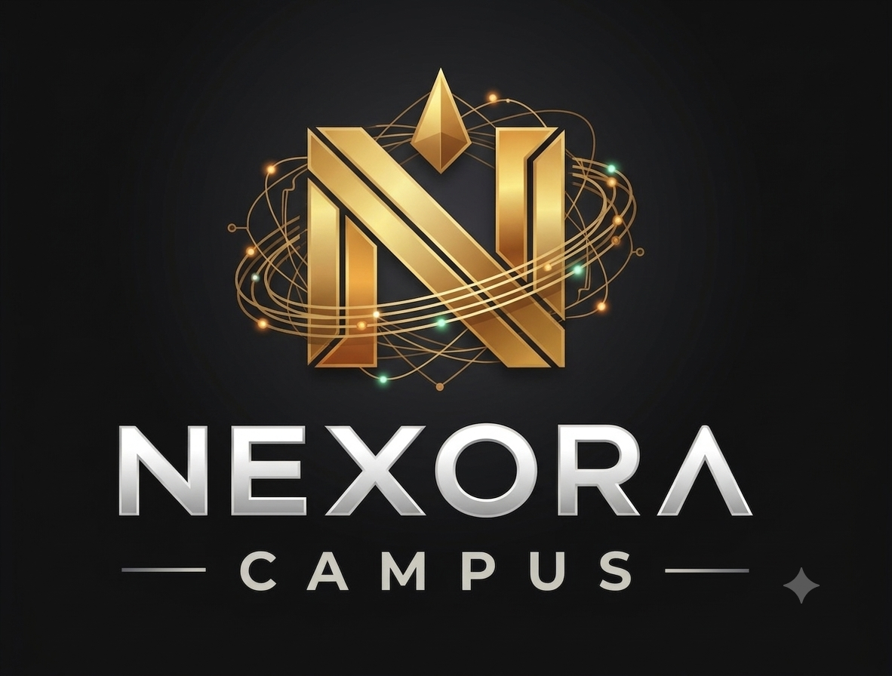
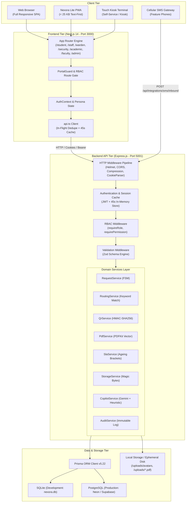

# Nexora Campus

<p align="center">
  
</p>

<p align="center">
  <strong>Centralized Campus Operations & Academic Management Platform</strong><br />
  <em>"Attendance, Mess, Hostel, Repeat: Campus Life, Debugged."</em>
</p>

<p align="center">
  <a href="#system-architecture"></a>
  <a href="https://nextjs.org"></a>
  <a href="https://nodejs.org"></a>
  <a href="https://prisma.io"></a>
  <a href="#security--rbac-matrix"></a>
  <a href="docs/TESTING.md"></a>
</p>

---

## 1. One-Line Description
A high-reliability, role-based campus operations engine that unifies student facility complaints with deterministic keyword routing, cryptographically signed gate passes, outstation leaves, tamper-evident bonafide certificates with public verification, cohort academic routine scheduling, faculty period attendance, and an integrated hybrid AI companion.

---

## 2. Problem Statement
Daily operations across university campuses are traditionally crippled by fragmented physical registers, manual paper chits, phone calls, and uncoordinated chat groups:
- **Hostel Maintenance Delays**: Broken room fixtures (fans, plumbing, lighting) logged in physical logbooks get delayed, lost, or untracked with zero technician accountability.
- **Curfew & Gate Security Vulnerabilities**: Handwritten gate passes are easily forged or shared; evening sentry checkpoints face long queues and lack tools to verify authenticity.
- **Academic Document Bureaucracy**: Obtaining an official Bonafide Certificate takes days of manual counter visits and stamping, with no instant third-party verification for bank loans or scholarships.
- **Attendance Uncertainty**: Students calculate attendance by guesswork and often discover shortages only after semester exam admit cards are withheld.
- **Infrastructure Blindspots**: Campus administration treats recurring breakdowns as isolated incidents, failing to recognize systemic failures like main line pipe bursts.
- **Low-Bandwidth Inequity**: Heavy web applications fail on congested campus Wi-Fi networks, leaving students on weak connections without access to essential services.

---

## 3. The Proposed Solution
Nexora Campus unifies campus administrative, residential, and academic workflows into a single event-driven digital platform:
1. **Deterministic Dispatch Engine**: Auto-assigns repair tickets to specialist technicians (plumbers, electricians, carpenters) in $< 5\text{ ms}$ based on keyword scoring.
2. **Dual-Mode Cryptographic Gate Passes**: Generates HMAC-SHA256 signed QR tokens and fallback 4-digit PINs verified by sentry camera terminals with strict anti-passback controls.
3. **Automated Vector PDF Synthesis**: Dynamically renders official university bonafide certificates with guilloche borders and embedded verification QR codes linked to a public zero-login registry (`/verify/[certificateId]`).
4. **Mathematical 75% Attendance Analytics**: Provides faculty with period-wise attendance logging (with duplicate session guards) and calculates safe class misses or needed attendances for students.
5. **Section 44 Clustering Intelligence**: Automatically alerts administrators when $\ge 3$ complaints occur in the same hostel block and category within 14 rolling days.
6. **Low-Bandwidth Accessibility**: Provides **Nexora Lite** ($< 25\text{ KB}$ text-first PWA), **Touch Kiosk Mode**, and an **Inbound SMS Gateway** for complete device and network inclusivity.
7. **Nexora Copilot**: A hybrid conversational assistant grounded in official BPUT procedures and live student telemetry that drafts pre-filled action cards for human-in-the-loop submission.

---

## 4. Key Features

| Capability | Module | Primary Users | Technical Implementation | Status |
|---|---|---|---|:---:|
| **Maintenance Ticket Engine** | Facility Ops | Students, Staff, Admin | Deterministic keyword scoring against `RoutingRule`; finite state machine progression to student rating | **IMPLEMENTED** |
| **Dual-Verification Gate Pass** | Campus Security | Students, Wardens, Security | HMAC-SHA256 signature calculated with server secret + 4-digit offline PIN; webcam QR scanner (`jsQR`) | **IMPLEMENTED** |
| **Hostel Outstation Leaves** | Residential Life | Students, Wardens | Multi-day leave requests with emergency guardian contacts and parental consent verification | **IMPLEMENTED** |
| **Vector PDF Bonafide Generator**| Academic Records| Students, Academic Officers | PDFKit dynamic A4 vector synthesis with embedded QR code and institutional registrar signature | **IMPLEMENTED** |
| **Public Document Verification** | Public Registry | External Verifiers, Public | Zero-login verification endpoint (`/verify/[certificateId]`) confirming validity while protecting PII | **IMPLEMENTED** |
| **Faculty Period Attendance** | Academic Portal | Faculty, Students | Period-wise class marking (`PRESENT`, `ABSENT`, `LATE`, `EXCUSED`) with duplicate session detection | **IMPLEMENTED** |
| **75% Attendance Margin Engine** | Academic Portal | Students, Academic Officers | Mathematical margin calculations (`safeMisses` when $\ge 75\%$, `neededAttends` when $< 75\%$) | **IMPLEMENTED** |
| **Weekly Routine & Timetable** | Academic Portal | Academic Officers, Students | Cohort scheduling by branch and year; personalized daily class routines | **IMPLEMENTED** |
| **Targeted Campus Notices** | Communications | Wardens, Academic Officers | Cohort-targeted announcements (by branch, year, semester, or hostel block) with read receipts | **IMPLEMENTED** |
| **Hostel Mess Menu Management** | Residential Life | Wardens, Students | Daily meal rosters (Breakfast, Lunch, Snacks, Dinner) with warden editing and student view | **IMPLEMENTED** |
| **Student Peer Mentorship** | Academic Guidance| Senior & Junior Students | Eligibility gate ($\text{Year} \ge 2$), mentorship request queue, and private contact shielding | **IMPLEMENTED** |
| **Nexora Copilot AI Assistant** | Intelligent Desk| All Roles (Primary Student) | Hybrid engine: Google Gemini REST API + offline deterministic heuristic fallback; Action Cards | **IMPLEMENTED** |
| **Section 44 Cluster Detection** | Operations Center| Campus Administrators | Proactive algorithmic detection of physical failure clusters ($\ge 3$ tickets in 14-day window) | **IMPLEMENTED** |
| **SLA Countdown & Ageing** | Operations Center| Staff, Administrators | Real-time countdown against priority SLAs; categorization into 4 ageing brackets (<12h, 12-24h, 24-48h, >48h)| **IMPLEMENTED** |
| **Immutable Security Audit Log** | Security & Audit| Campus Administrators | Append-only audit trail logging actor, action, entity, IP address, user agent, and before/after diffs | **IMPLEMENTED** |
| **Nexora Lite PWA** | Accessibility | Students (Low Bandwidth) | Ultra-lightweight ($< 25\text{ KB}$) text-first PWA interface (`/lite`) for 2G/3G campus connections | **IMPLEMENTED** |
| **Touch Kiosk Mode** | Accessibility | Students (Hardware Terminal) | Shared touchscreen terminal interface (`/kiosk`) for roll number lookup without a smartphone | **IMPLEMENTED** |
| **Inbound SMS Gateway** | Accessibility | Feature Phone Users | Webhook endpoint (`/api/integrations/sms/inbound`) parsing formatted SMS into tickets and passes | **IMPLEMENTED** |
| **Emergency SOS Siren Broadcast** | Campus Safety | Students, Security, Wardens | Route mounted in `app.ts` (`/api/emergency`); in-memory emergency cache and sentry alerts | **IMPLEMENTED** |
| **Nexora Lite (Non-Student Roles)**| Accessibility | Staff, Wardens, Security | Dedicated view components exist; unified routing in `/lite/page.tsx` pending | **PARTIALLY IMPLEMENTED** |
| **Outbound Cellular SMS Delivery**| Communications | All Roles | Inbound webhook active; external carrier delivery (Twilio/AWS SNS) planned | **PLANNED** |
| **SMTP / Email Notifications** | Communications | All Roles | In-app notification bell active; external SMTP transport planned | **PLANNED** |
| **Biometric Facial Verification** | Security Sentry | Security Officers | QR and PIN sentry active; camera-based facial recognition on roadmap | **PLANNED** |

---

## 5. Role-Specific Capabilities

The system enforces strict Role-Based Access Control (RBAC) backed by 6 database roles, 24 granular permissions, and 8 pre-seeded demo personas:

| Role Name | Default Demo Account | Primary Responsibilities & Permissions |
|---|---|---|
| **Student** (`STUDENT`) | `aryan@nexora.edu` | Log maintenance tickets, apply for gate passes and leaves, generate bonafides, check 75% attendance margins, view timetable and mess menu, connect with peer mentors, use Copilot. |
| **Maintenance Staff** (`STAFF`) | `ramesh@nexora.edu` (Plumbing)<br />`suresh@nexora.edu` (Electrical) | Receive auto-assigned trade tickets, accept jobs, record repair notes, mark work orders resolved, track SLA countdowns and view student ratings. |
| **Hostel Warden** (`WARDEN`) | `warden.b@nexora.edu` | Review and approve/reject gate passes and overnight leaves for their specific hostel block, inspect resident student rosters, publish hostel notices, manage mess menus. |
| **Security Officer** (`SECURITY`) | `security.gate1@nexora.edu` | Operate gate sentry terminal, scan gate pass QR codes via webcam scanner, enter offline 4-digit PINs, log exit/entry timestamps, inspect live gate activity feed. |
| **Academic Officer** (`ACADEMIC_OFFICER`)| `academic@nexora.edu` | Manage subject catalogs, configure weekly class timetables, broadcast academic notices and deadlines, approve bonafide certificate requests, audit campus attendance compliance. |
| **Faculty Member** (`FACULTY` / `STAFF`) | `faculty@nexora.edu` | Conduct period-wise class attendance sessions, utilize duplicate session protection, inspect historical attendance records, review at-risk students below 75%. |
| **Campus Administrator** (`ADMIN`) | `admin@nexora.edu` | Directorate Command Center, Section 44 clustered failure alerts, SLA ageing analytics, technician workload monitoring, immutable security audit logs. |

*Default password for all pre-seeded demo accounts:* **`Password123!`**

---

## 6. Nexora Copilot Conversational Assistant

Nexora Copilot (`/student/copilot`) is an intelligent operations and academic companion modeled around **Biju Patnaik University of Technology (BPUT, Bhubaneswar)**:

### 6.1 "Ask. Solve. Plan. Guide." Architecture
- **Ask (Grounded Q&A)**: Answers academic rules, grading policies, hostel curfews, and procedures grounded strictly in verified institutional data (`campusGuide.data.ts` and `campusKnowledge.data.ts`).
- **Solve (Transactional Action Cards)**: Understands intent to perform campus operations and renders pre-filled interactive cards:
  - `ACTION_MAINTENANCE`: Pre-filled room repair ticket (category, location, priority).
  - `ACTION_GATE_PASS`: Pre-filled gate pass application (destination, curfew-checked times).
  - `ACTION_LEAVE`: Pre-filled hostel outstation leave application.
  - `ACTION_BONAFIDE`: Pre-filled bonafide certificate request.
- **Plan (Academic Roadmaps)**: Synthesizes structured, multi-day exam study roadmaps (`STUDY_PLAN`) tailored to syllabus topics (DBMS, Operating Systems, DSA, Digital Electronics, Computer Networks) with daily collapsible task checklists.
- **Guide (Procedural Guidance)**: Outputs step-by-step checklists (`GUIDE_PROCEDURE`) for 12 official institutional procedures with department locations, turnaround times, and required physical documents.

### 6.2 Hybrid AI & Zero-Downtime Fallback
1. **Primary Cloud AI Engine**: Direct HTTPS integration with Google Gemini Generative Language REST API (`gemini-flash-lite-latest`, `gemini-flash-latest`, `gemini-2.5-flash-lite`) with a 6-second timeout.
2. **Deterministic Heuristic Engine**: Zero-failure local keyword and rule-based parser that executes offline whenever `GEMINI_API_KEY` is unconfigured, unreachable, or times out.
3. **Human-in-the-Loop Safety Gate**: Copilot *drafts* actions; it **never** mutates database state autonomously. The user must review the card and explicitly click confirmation to invoke authenticated backend domain endpoints.

---

## 7. Technology Stack

| Layer | Component | Version | Role in Platform |
|---|---|---|---|
| **Frontend Framework** | Next.js (App Router) | `14.2.35` | Server-rendered and client React architecture, nested role layouts (`frontend/app`) |
| **Frontend UI Library** | React | `18.3.1` | Declarative UI components, state management, and custom context hooks |
| **Full-Stack Language** | TypeScript | `5.7.2` | Static type definitions, strict compile-time checks, and shared data contracts |
| **Backend Framework** | Express.js | `4.21.2` | RESTful API routing, middleware pipeline, and HTTP server (`backend/src/app.ts`) |
| **Database ORM** | Prisma Client & CLI | `5.22.0` | Type-safe query building, relation management, and schema migrations (`schema.prisma`) |
| **Database Engine** | SQLite (Dev) / Postgres (Prod) | Embedded / v15+ | Relational data persistence storing 38 models in `prisma/nexora.db` |
| **CSS & Styling** | Tailwind CSS | `3.4.16` | Responsive utility styling with dark-academic and slate theme tokens |
| **Icons** | Lucide React | `0.468.0` | Production SVG iconography across all portals and status badges |
| **Schema Validation** | Zod | `3.24.1` | Runtime schema validation for request payloads and input sanitization |
| **Authentication** | JSON Web Tokens (`jsonwebtoken`) | `9.0.2` | Signed stateless session tokens stored in HTTP-only cookies and Bearer headers |
| **Password Hashing** | bcryptjs | `2.4.3` | Adaptive one-way password hashing using 10 salt rounds |
| **Document Generation**| PDFKit | `0.16.0` | Vector-rendered official academic PDF generation with embedded QR codes |
| **QR Code Engine** | QRCode & qrcode.react | `1.5.4` / `4.2.0` | Server-side image buffer generation and client-side SVG/Canvas rendering |
| **Barcode Scanner** | jsQR | `1.4.0` | Real-time webcam barcode decode in Sentry Scanner |
| **Security Headers** | Helmet | `8.0.0` | Configures HTTP security headers (CSP, HSTS, Sniffing protection) |
| **Cookie Parsing** | cookie-parser | `1.4.7` | Parses incoming cookie headers for HTTP-only JWT session extraction |
| **CORS Middleware** | cors | `2.8.5` | Handles cross-origin requests from frontend (port 3000) to API (port 5001) |
| **Payload Compression**| compression | `1.8.2` | Gzip response compression for optimized data transfer over slow connections |
| **Automated Testing** | Jest & Supertest | `29.7.0` / `7.0.0` | Integration and unit test runners validating backend test cases |
| **Process Orchestrator**| concurrently | `9.2.4` | Concurrently boots frontend and backend in local development (`npm run dev`) |

---

## 8. System Architecture

<p align="center">
  
</p>



---

## 9. Repository Structure

```text
Nexora/
├── backend/                       # Express.js + TypeScript Backend Application
│   ├── dist/                      # Compiled JavaScript output
│   ├── prisma/                    # Database models, migrations, and seeds
│   │   ├── migrations/            # Version-controlled SQL migrations
│   │   ├── nexora.db              # Local SQLite database file (active store)
│   │   ├── schema.prisma          # Prisma schema definition (38 models)
│   │   ├── seed.ts                # Master database seed script (8 demo personas)
│   │   ├── seed_attendance.ts     # Specialized academic attendance seed script
│   │   └── seed_mess_menu.ts      # Hostel mess menu weekly schedule seed script
│   ├── src/                       # Application source code
│   │   ├── config/                # env.ts (environment parsing), prisma.ts (singleton)
│   │   ├── data/                  # campusGuide.data.ts, campusKnowledge.data.ts, campusResources.data.ts
│   │   ├── middleware/            # auth, error, rateLimit, rbac, validate middlewares
│   │   ├── routes/                # 20 Express route controllers
│   │   ├── services/              # 12 domain services (routing, request, qr, pdf, copilot, gemini, etc.)
│   │   ├── tests/                 # 11 Jest test suites
│   │   ├── app.ts                 # Express application & route mounting
│   │   └── server.ts              # Server bootstrapper & port listener
│   ├── .env.example               # Backend local environment template
│   ├── .env.production.example    # Backend production environment template
│   ├── package.json               # Backend dependencies and scripts
│   └── tsconfig.json              # Backend TypeScript compiler configuration
├── docs/                          # Detailed Technical Documentation Directory
│   ├── images/                    # Architectural images and diagrams
│   │   └── nexora-architecture.png# Visual system architecture diagram
│   ├── ARCHITECTURE.md            # Deep-dive system architecture specification
│   ├── COPILOT.md                 # Complete Nexora Copilot technical reference
│   ├── FEATURES.md                # Comprehensive feature and capability catalog
│   ├── SECURITY.md                # Security model, cryptographic signing & threat audit
│   ├── TESTING.md                 # Test suite documentation, commands & QA runbooks
│   └── DEPLOYMENT.md              # Local zero-setup runbook & cloud deployment guide
├── frontend/                      # Next.js 14 App Router Frontend Application
│   ├── app/                       # 65 application pages across 7 role cockpit portals
│   │   ├── academic/              # Academic Officer catalog, routines, notices, approvals
│   │   ├── admin/                 # Command Center, SLA ageing, Section 44, audit logs
│   │   ├── faculty/               # Faculty period attendance marking & history sheets
│   │   ├── kiosk/                 # Touch Kiosk touchscreen terminal mode
│   │   ├── lite/                  # Nexora Lite ultra-lightweight (<25KB) student PWA
│   │   ├── security/              # Security Sentry scanner (jsQR webcam + PIN keypad)
│   │   ├── staff/                 # Technician work order queue & lifecycle progression
│   │   ├── student/               # Student cockpit, requests, gate pass, leave, copilot
│   │   └── verify/                # Public zero-login document verification page
│   ├── components/                # Shared UI design system, navigation bar, modals
│   ├── lib/                       # api.ts (HTTP client with dedupe), auth-context.tsx
│   ├── public/                    # Static assets, Logo.png, PWA icons
│   ├── .env.example               # Frontend local environment template
│   ├── .env.production.example    # Frontend production environment template
│   ├── package.json               # Frontend dependencies and scripts
│   ├── tailwind.config.ts         # Theme tokens (dark-academic & slate styling)
│   └── tsconfig.json              # Frontend TypeScript compiler configuration
├── CONTRIBUTING.md                # Contribution guidelines, code standards & PR workflows
├── Logo.png                       # High-resolution Nexora Campus emblem
├── package.json                   # Monorepo root workspace configuration & scripts
├── package-lock.json              # Dependency lockfile
├── render.yaml                    # Render cloud deployment specification (Backend PaaS)
└── README.md                      # Primary project presentation and documentation
```

---

## 10. Prerequisites

Before installing Nexora Campus, verify that your local environment meets:
- **Node.js**: `v20.x` or `v22.x` (LTS recommended)
- **npm**: `v10.x` or higher
- **Git**: `v2.x`
- **Operating System**: macOS, Linux, or Windows (WSL recommended)

---

## 11. Installation and Setup Instructions

Nexora Campus features an **instant, zero-setup developer experience** using embedded SQLite:

```bash
# 1. Clone the repository
git clone https://github.com/munazirhussan910-cpu/nexora-campus.git
cd nexora-campus

# 2. Copy environment variable templates
cp backend/.env.example backend/.env
cp frontend/.env.example frontend/.env.local

# 3. Execute automated zero-setup script
# (Installs dependencies across workspaces, pushes schema, and seeds demo personas)
npm run setup
```

---

## 12. Environment Variable Configuration

### Backend (`backend/.env`):
```ini
# SQLite database path (Zero setup required)
DATABASE_URL="file:./nexora.db"

# Express server listening port
PORT=5001

# JWT signing secret (use 32+ character random string in production)
JWT_SECRET="nexora-campus-secret-key-2026-bput-hackathon"

# Backend application public URL
APP_URL="http://localhost:5001"

# Frontend application public URL (configured in CORS)
FRONTEND_URL="http://localhost:3000"

# Local storage directory for avatars and generated PDFs
STORAGE_DIR="./uploads"

# Runtime mode
NODE_ENV="development"

# Optional: Google Gemini API key for Nexora Copilot generative reasoning
# (If unset, Copilot seamlessly runs on its offline deterministic heuristic engine)
GEMINI_API_KEY=""
```

### Frontend (`frontend/.env.local`):
```ini
# Base URL for backend API requests
NEXT_PUBLIC_API_URL=http://localhost:5001/api
```

---

## 13. Database Setup Instructions

The database is managed through Prisma ORM:

```bash
# Generate Prisma Client bindings
npm run db:generate

# Push schema directly to the database
npm run db:push

# Seed standard campus data and 8 demo personas
npm run db:seed
```

---

## 14. Development Commands

From the repository root:

```bash
# Boot both backend (port 5001) and frontend (port 3000) concurrently
npm run dev

# Boot backend only
npm run dev:backend

# Boot frontend only
npm run dev:frontend
```

---

## 15. Test Commands

```bash
# Run backend test suites
npm run test --workspace=backend

# Run frontend TypeScript type checking
npx --prefix frontend tsc --noEmit

# Run backend TypeScript type checking
npx --prefix backend tsc --noEmit

# Run frontend production build (verifies all 65 routes)
npm run build --workspace=frontend
```

*For detailed test execution notes and sandbox constraints, refer to [docs/TESTING.md](docs/TESTING.md).*

---

## 16. Deployment Overview

- **Backend**: Containerized web service on **Render** (configured via `render.yaml`).
- **Frontend**: Edge-optimized server-rendered application on **Vercel**.
- **Database**: Embedded **SQLite** for development; managed **PostgreSQL** (Neon, Supabase, AWS RDS) for production.
- **File Storage**: Local `/uploads` directory in development; ephemeral `/tmp/uploads` with dual database persistence on Render free tier.

*For complete cloud provisioning instructions, refer to [docs/DEPLOYMENT.md](docs/DEPLOYMENT.md).*

---

## 17. Known Limitations

1. **In-Memory Emergency SOS Cache**: Emergency alert broadcasts currently use an in-memory event cache; scaling to multiple backend instances will require a shared Redis Pub/Sub layer.
2. **Outbound Cellular SMS Transport**: Inbound SMS webhooks parse text tickets effectively, but outbound SMS delivery (via Twilio/AWS SNS) is not currently connected to live cellular networks.
3. **External Email Transport**: In-app notification feeds function across all roles, but outbound SMTP/SendGrid delivery is not yet configured.
4. **Local Socket Listeners in Older Test Suites**: Several older integration test suites bind physical sockets (`server.listen`), which trigger `listen EPERM` in restricted sandbox environments. Modern test suites (`mess_menu.test.ts`) demonstrate the recommended in-memory pattern.

---

## 18. Future Improvements

1. **Redis Integration**: Distributed caching and background message queues (BullMQ) for high-volume campus broadcasts.
2. **Cloud Object Storage Adapter**: Native AWS S3 or Cloudflare R2 integration for persistent PDF certificates and avatar image storage.
3. **Biometric Face Verification**: Integrating computer vision facial recognition at sentry gatehouses to complement QR tokens and PINs.
4. **WebSocket Push Notifications**: Full-duplex WebSocket connections for instantaneous sentry turnstile updates and technician dispatch.

---

## 19. Team Information

Developed for the **BPUT Hackathon 2026** by:

**Team CIPHER**  
*Biju Patnaik University of Technology (BPUT), Bhubaneswar*

---

## 20. Links to Detailed Technical Documentation

- 🏛️ **[docs/ARCHITECTURE.md](docs/ARCHITECTURE.md)**: Deep-dive modular monolith design, FSM state machines, data flow diagrams, and domain service taxonomy.
- 🤖 **[docs/COPILOT.md](docs/COPILOT.md)**: Comprehensive specification of Nexora Copilot, Gemini model failover, Action Cards, and prompt guardrails.
- 📋 **[docs/FEATURES.md](docs/FEATURES.md)**: Complete catalog of all implemented features, role-specific capabilities, and implementation statuses.
- 🔒 **[docs/SECURITY.md](docs/SECURITY.md)**: Security architecture, HMAC-SHA256 signing, magic byte image validation, and threat modeling.
- 🧪 **[docs/TESTING.md](docs/TESTING.md)**: Test suite inventory, verified test results, build diagnostics, and QA manual runbooks.
- 🚀 **[docs/DEPLOYMENT.md](docs/DEPLOYMENT.md)**: Local zero-setup runbook, cloud infrastructure topography, and Render/Vercel guides.
- 🤝 **[CONTRIBUTING.md](CONTRIBUTING.md)**: Code of conduct, coding standards, branch naming, and pull request workflows.
