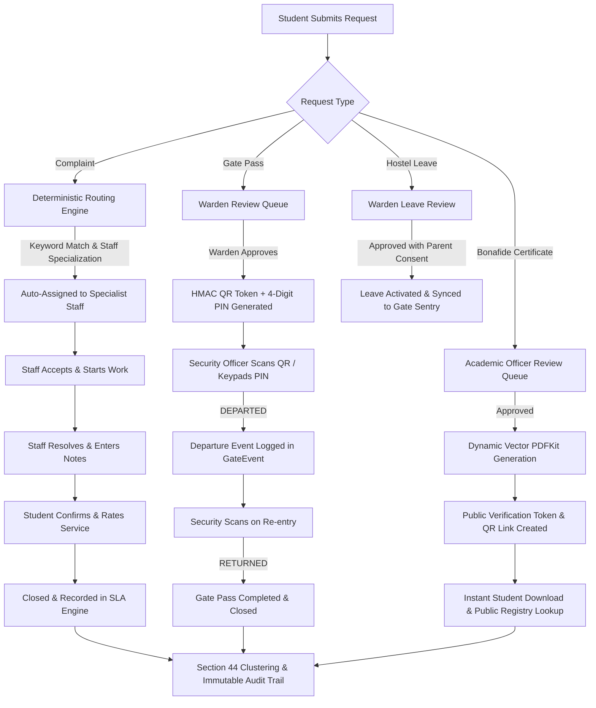
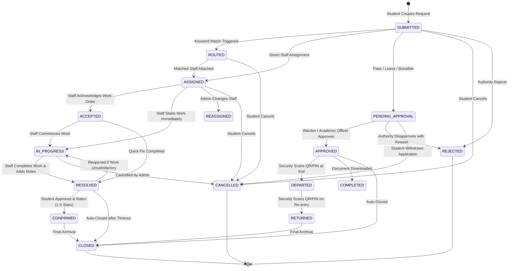
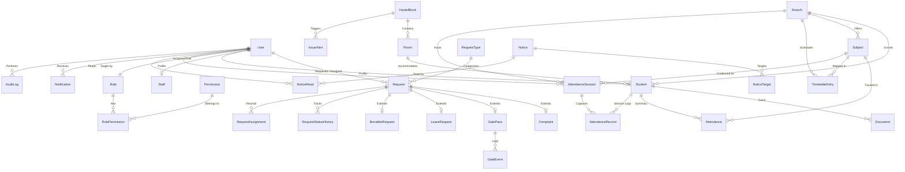

# Nexora Campus

> **Centralized Campus Operations & Academic Management Engine**  
> A unified, role-based operations platform engineered to digitize student maintenance complaints with deterministic keyword routing, cryptographically signed gate passes, hostel leaves, tamper-evident bonafide certificates with public verification, targeted announcements, academic scheduling, and faculty attendance tracking. Built for the **BPUT Hackathon 2026** under the theme: *"Attendance, Mess, Hostel, Repeat: Campus Life, Debugged."*

[](https://github.com/munazirhussan910-cpu/nexora-campus)
[](#system-architecture)
[-black?style=flat-square&logo=next.js)](https://nextjs.org)
[](https://nodejs.org)
[-2D3748?style=flat-square&logo=prisma)](https://prisma.io)
[](#authentication--security)
[-brightgreen?style=flat-square&logo=jest)](#testing)

---

## Table of Contents

- [Overview](#overview)
- [Problem Statement](#problem-statement)
- [Solution](#solution)
- [Key Features](#key-features)
- [User Roles & Personas](#user-roles--personas)
- [Technology Stack](#technology-stack)
- [System Architecture](#system-architecture)
- [Application Flow & Request Lifecycle](#application-flow--request-lifecycle)
- [Project Structure](#project-structure)
- [Database Architecture](#database-architecture)
- [API Documentation](#api-documentation)
- [Authentication & Authorization](#authentication--authorization)
- [Important Technical Implementation](#important-technical-implementation)
- [Setup & Installation](#setup--installation)
- [Environment Variables](#environment-variables)
- [Running Locally](#running-locally)
- [Deployment](#deployment)
- [Security Implementation](#security-implementation)
- [Engineering Decisions & Trade-offs](#engineering-decisions--trade-offs)
- [Challenges & Mitigations](#challenges--mitigations)
- [Testing](#testing)
- [Known Limitations & Implementation Status](#known-limitations--implementation-status)
- [Future Improvements](#future-improvements)
- [Explain Any File Reference](#explain-any-file-reference)
- [Interview Preparation](#interview-preparation)
  - [60-Second Verbal Explanation](#60-second-verbal-explanation)
  - [2-Minute Technical Explanation](#2-minute-technical-explanation)
  - [Beginner Questions (10)](#beginner-questions)
  - [Intermediate Questions (15)](#intermediate-questions)
  - [Advanced Questions (15)](#advanced-questions)
  - [Architecture Questions (10)](#architecture-questions)
  - [Database Questions (10)](#database-questions)
  - [Security Questions (10)](#security-questions)
  - [Backend & API Questions (10)](#backend--api-questions)
  - [Frontend Questions (10)](#frontend-questions)
  - [Common Follow-up Questions](#common-follow-up-questions)
- [License](#license)

---

## Overview

### What Nexora Campus Is
**Nexora Campus** is a production-grade, centralized campus operations engine and academic portal designed to replace fragmented paper registers, manual gate slips, counter-based certificate stamping, unstructured WhatsApp notices, untracked hostel maintenance tasks, and disconnected classroom attendance sheets with an integrated, event-driven web platform.

### Problem Being Solved
On university campuses, daily operations (maintenance repairs, weekend gate passes, outstation leaves, bonafide verification, targeted notices, class scheduling, and attendance logging) are traditionally handled via disconnected physical registers, manual paper chits, phone calls, and informal chat groups. This leads to lost tickets, bureaucratic certificate delays, security vulnerabilities at campus gates, absence of service-level agreement (SLA) tracking, and administrative blindspots regarding recurring infrastructure failures.

### Target Users
- **Students**: Raise maintenance tickets, apply for gate passes/leaves, generate bonafide certificates, track 75% attendance thresholds with mathematical margin alerts, view timetables, and receive targeted notices.
- **Maintenance Staff / Technicians**: Receive auto-assigned tickets (Plumbing, Electrical, Carpentry, IT, Cleanliness), accept jobs, update progress, document repair notes, and view performance ratings.
- **Hostel Wardens**: Review and approve/reject gate passes and overnight leaves for their specific hostel block, inspect room rosters, track curfew compliance, and broadcast notices.
- **Security Officers**: Sentry terminal for high-speed camera QR scanning or 4-digit PIN fallback to authorize student departures and returns with exact timestamp logging.
- **Academic Officers**: Manage department subject catalogs, schedule weekly class timetables, broadcast academic notices, and audit campus-wide 75% attendance compliance.
- **Faculty / Professors**: Take period-wise subject attendance, record attendance statuses (`PRESENT`, `ABSENT`, `LATE`, `EXCUSED`), review subject attendance histories, and publish class-specific announcements.
- **Campus Administrators**: Operations Command Center with real-time operational metrics, Section 44 clustered infrastructure failure detection, SLA ageing analytics, staff workload monitors, and immutable audit logs.

### Current Implementation Status
The project is a fully working **Modular Monolith** with a decoupled Express/TypeScript backend (`backend/src`) and Next.js 14 App Router frontend (`frontend/app`). It includes 33 Prisma database models, 16 route controllers, 8 domain services, 43 automated integration tests, and 8 pre-seeded demo accounts.

---

## Problem Statement

| Problem Area | Traditional Campus Process | Failure Mode / Operational Cost | Nexora Campus Solution |
|---|---|---|---|
| **Hostel Maintenance** | Physical complaint registers at hostel gatehouses | Complaints lost, ignored, or untracked; zero technician accountability; no visibility into repair time. | Deterministic keyword routing assigns specialist staff in $< 5\text{ ms}$; strict Finite State Machine (FSM); student confirmation & rating. |
| **Gate Passes & Curfew** | Handwritten paper slips signed by wardens | Easily forged; lost slips; long queues during evening curfew; security sentries cannot verify authenticity. | Dual-mode cryptographic gate pass: HMAC-SHA256 signed QR code + 4-digit offline PIN fallback; real-time departure/return logging. |
| **Academic Certificates** | In-person visits to academic cell; multi-day manual signing | 3–5 business day delays; third-party verification impossible without manual phone/email queries. | Automated vector PDF synthesis via PDFKit with embedded verification QR code; public zero-login registry at `/verify/[certificateId]`. |
| **Hostel Leaves** | Physical application with unverified phone calls | Inability to audit parental consent; no coordination with perimeter gatehouse sentries. | Structured multi-day leave workflow with emergency contact, parental consent flag, and warden review. |
| **Infrastructure Failures** | Repairs treated in isolation across rooms | Systemic failures (e.g. corrupted main water line) treated as isolated broken taps. | **Section 44 Clustering Intelligence**: Flags clusters when $\ge 3$ complaints occur in the same hostel block & category within 14 days. |
| **Network & Device Inequity** | Heavy SPAs fail on congested 2G/3G hostel Wi-Fi | Students with poor network or feature phones cannot access campus services. | **Nexora Lite** ($< 25\text{ KB}$ text-first interface), **Touch Kiosk Mode**, and **Inbound SMS Gateway** (`/api/integrations/sms/inbound`). |
| **Attendance & Timetable** | Paper attendance sheets; disconnected timetable PDFs | Manual attendance entry errors; students unaware of exact attendance margins before semester exams. | Faculty digital period attendance, live weekly timetable, and mathematical margin calculator (`safeMisses` / `neededAttends` to maintain 75%). |

---

## Solution

Nexora Campus unifies all campus operations into an event-driven digital pipeline:



---

## Key Features

### 1. Student Operational Cockpit
- **Unified Request Tracking**: Real-time status badges, chronological activity timeline, and SLA countdowns across complaints, passes, leaves, and certificates.
- **Maintenance Complaint Submission**: Categorized under Plumbing, Electrical, Carpentry, IT/Network, and Cleanliness with location specifiers and image attachments.
- **Two-Tier Service Closure**: Tickets cannot be closed unilaterally by technicians; students must confirm resolution and submit a 1–5 star rating with feedback.
- **Cryptographic Gate Pass**: Day or weekend leave requests; upon warden approval, generates an HMAC-signed dynamic QR code and 4-digit numeric fallback PIN.
- **Hostel Leave Application**: Multi-day outstation leave submission with emergency guardian contacts and parental consent declarations.
- **Instant Bonafide Certificate**: Select institutional purpose (Scholarship, Bank, Internship, Higher Studies), trigger review, and download signed vector PDFs upon approval.
- **Academic Cockpit & 75% Attendance Analytics**: Subject-wise attendance breakdown, overall attendance percentage, recent 30-day session logs, and mathematical margin insights:
  - *Above 75%*: $\text{Safe Misses} = \lfloor(\text{Present} - 0.75 \times \text{Total}) / 0.75\rfloor$
  - *Below 75%*: $\text{Needed Attends} = \lceil(0.75 \times \text{Total} - \text{Present}) / 0.25\rceil$
- **Class Timetable & Notices**: Day-wise and weekly timetable schedule matching branch and year; targeted campus notices filtered to cohort.

### 2. Maintenance & Facility Operations (Staff)
- **Specialized Work Order Queue**: Filtered work orders mapped to technician specialization (Plumbing, Electrical, Carpentry, IT, General Maintenance).
- **Sequential Lifecycle Progression**: Action buttons strictly enforcing the state machine: `ASSIGNED` &rarr; `ACCEPTED` &rarr; `IN_PROGRESS` &rarr; `RESOLVED`.
- **Resolution Documentation**: Mandatory form capturing repair actions, replaced parts, and technical notes.
- **Historical Metrics & Ratings**: Technician dashboard showing completed work orders, average resolution times, and student satisfaction ratings.

### 3. Hostel Wardens Hub
- **Block-Scoped Command Center**: Resident counts, active maintenance tickets, pending leaves, and active gate passes filtered to the warden's assigned hostel block.
- **Gate Pass Review**: Single-pane review of student exit requests with one-click approval (auto-generating credentials) or rejection with mandatory feedback.
- **Leave Application Verification**: Verify emergency guardian phone numbers and parent consent flags before approving outstation travel.
- **Hostel Resident Directory**: Searchable roster of block residents by roll number, room number, branch, and contact details.

### 4. Gatehouse Sentry Terminal (Security)
- **High-Speed Dual Verification**: Camera barcode scanner for real-time QR decoding, backed by an immediate 4-digit PIN keypad entry.
- **Resident Profile Modal**: Display verified student photo placeholder, full name, roll number, hostel block, room number, emergency phone, and destination upon scan.
- **Perimeter Movement Logging**: One-click logging for `DEPARTED` and `RETURNED` events with sub-second timestamp auditing in `GateEvent`.
- **Anti-Passback & One-Time Use**: Expired, already-returned, or cancelled passes are immediately rejected with high-contrast visual and audio cues.

### 5. Academic Officer Administration
- **Department Subject Catalog**: CRUD operations on academic subjects with unique subject codes, branch mapping, year, semester, section, and faculty assignments.
- **Timetable Scheduling Engine**: Configure weekly class schedules with period time slots, lecture rooms, and instructor assignments.
- **Official Class Updates**: Publish targeted academic notices (class rescheduling, test dates, lab venues) filtered by branch, year, semester, section, or subject.
- **Campus Attendance Audit**: Read-only oversight of subject attendance across all departments with 75% threshold compliance flags.

### 6. Faculty Attendance Portal
- **Class Schedule Overview**: View today's assigned teaching periods, lecture halls, and subject codes.
- **Session Attendance Marking**: Mark period-wise attendance for student cohorts with statuses: `PRESENT`, `ABSENT`, `LATE`, `EXCUSED`.
- **Duplicate Session Detection**: Backend validation checks if an attendance session has already been recorded for that subject, section, date, and period.
- **Day-Wise & Subject Attendance History**: Inspect attendance distribution trends, edit past session records, and view historical class sheets.

### 7. Administrative Command Center
- **Executive Telemetry**: Real-time counters for Total Requests, Active Open Tickets, SLA Breaches, Pending Approvals, Today's Resolutions, and Active Technicians.
- **Section 44 Clustered Issue Detection**: Autonomous intelligence identifying recurring physical failures when $\ge 3$ complaints occur in the same hostel block & category within a rolling 14-day window.
- **SLA Ageing Distribution**: Real-time categorization of open tickets into 4 ageing brackets (`< 12h`, `12–24h`, `24–48h`, `> 48h`) and campus compliance percentages.
- **Technician Roster & Workload**: Real-time staff queue tracking to prevent technician overload and reassign stalled tickets.
- **Immutable Audit Trail**: Append-only log recording actor ID, action code, entity type, entity ID, JSON diffs of previous vs. new values, IP address, and browser user agent.

### 8. Alternative Accessibility Channels
- **Nexora Lite (`/lite`)**: Ultra-low-bandwidth text-first interface ($< 25\text{ KB}$ total transfer) for weak 2G/3G connections with tailored views for all 6 roles.
- **Touch Kiosk Mode (`/kiosk`)**: Self-service walk-up terminal interface optimized for touchscreen hardware; allows roll-number lookup and ticket logging without a personal device.
- **Inbound SMS Gateway (`/api/integrations/sms/inbound`)**: Webhook endpoint accepting structured SMS text payloads (e.g. `TICKET B204 TAP LEAKING`) for non-smartphone users.
- **Public Verification Registry (`/verify/[certificateId]`)**: Zero-login public verification endpoint for external banks, employers, and scholarship boards to verify certificate authenticity with private PII redacted.

---

## User Roles & Personas

The system implements Role-Based Access Control (RBAC) backed by 6 database roles and 24 granular permissions.

### Role Permission Matrix

| Permission Code | Description | STUDENT | STAFF / FACULTY | WARDEN | SECURITY | ACADEMIC_OFFICER | ADMIN |
|---|---|:---:|:---:|:---:|:---:|:---:|:---:|
| `requests.create` | Submit complaints & campus requests | &check; | | | | | &check; |
| `requests.view.own` | View own submitted requests | &check; | &check; | | | | &check; |
| `requests.view.all` | View all requests across campus | | | &check; | | | &check; |
| `requests.assign` | Assign requests to technicians | | | | | | &check; |
| `requests.reassign` | Reassign tickets between staff | | | | | | &check; |
| `requests.resolve` | Mark maintenance tickets resolved | | &check; | | | | &check; |
| `gatepass.create` | Apply for student gate pass | &check; | | | | | &check; |
| `gatepass.approve` | Approve student gate pass | | | &check; | | | &check; |
| `gatepass.reject` | Reject student gate pass | | | &check; | | | &check; |
| `gatepass.verify` | Verify QR/PIN at gate sentry | | | | &check; | | &check; |
| `leave.create` | Submit hostel outstation leave | &check; | | | | | &check; |
| `leave.approve` | Approve hostel outstation leave | | | &check; | | | &check; |
| `leave.reject` | Reject hostel outstation leave | | | &check; | | | &check; |
| `bonafide.create` | Apply for bonafide certificate | &check; | | | | | &check; |
| `bonafide.approve` | Approve bonafide & generate PDF | | | | | &check; | &check; |
| `bonafide.reject` | Reject bonafide certificate request | | | | | &check; | &check; |
| `academic.dashboard` | Access Academic Officer console | | | | | &check; | &check; |
| `academic.subject.*` | CRUD on department subjects | | | | | &check; | &check; |
| `academic.timetable.*`| CRUD on class timetable schedule | | | | | &check; | &check; |
| `academic.attendance.read`| View campus attendance records | | | | | &check; | &check; |
| `notices.view` | View cohort targeted notices | &check; | &check; | &check; | &check; | &check; | &check; |
| `notices.create` | Publish targeted notices | | | &check; | | &check; | &check; |
| `analytics.view` | Access Command Center telemetry | | | | | | &check; |
| `audit.view` | Inspect immutable audit logs | | | | | | &check; |
| `staff.manage` | Manage technician directory | | | | | | &check; |
| `students.manage` | Manage student records | | | &check; | | | &check; |

### Pre-Seeded Demo Personas

All accounts are seeded in `backend/prisma/seed.ts` with the password: **`Password123!`**

| Persona Name | Role | Email | Profile & Scope |
|---|---|---|---|
| **Aryan Khan** | `STUDENT` | `aryan@nexora.edu` | B.Tech CSE, 2nd Year, Hostel Block B, Room 204. Full student portal access. |
| **Ramesh Kumar** | `STAFF` | `ramesh@nexora.edu` | Senior Maintenance Plumber. Receives auto-routed plumbing work orders. |
| **Suresh Verma** | `STAFF` | `suresh@nexora.edu` | Senior Electrician. Receives auto-routed electrical breakdown tasks. |
| **Dr. S. K. Mohapatra** | `WARDEN` | `warden.b@nexora.edu` | Chief Warden, Hostel Block B. Reviews gate passes, leaves, and block complaints. |
| **Vikram Singh** | `SECURITY` | `security.gate1@nexora.edu` | Gate Operations Officer, Main Gate. Sentry terminal with camera QR & PIN keypad. |
| **Prof. Sanjeev Mohanty** | `ACADEMIC_OFFICER` | `academic@nexora.edu` | Academic Officer. Manages subjects, timetables, updates, and bonafides. |
| **Dr. P. K. Tripathy** | `STAFF` (Faculty) | `faculty@nexora.edu` | Professor & Faculty (CSE). Marks class attendance and reviews student histories. |
| **Dr. Ananya Ray** | `ADMIN` | `admin@nexora.edu` | Chief Campus Operations Director. Full access to Command Center & audit logs. |

---

## Technology Stack

### Master Technology Matrix

| Layer | Technology | Version | Purpose in Codebase |
|---|---|---|---|
| **Frontend Framework** | Next.js (App Router) | `14.2.20` | Server-rendered and client React architecture, nested role layouts (`frontend/app`) |
| **Frontend UI Library** | React | `18.3.1` | Declarative UI components, state management, and custom context hooks |
| **Full-Stack Language** | TypeScript | `5.7.2` | Static type definitions, strict compile-time checks, and shared data contracts |
| **Backend Framework** | Express.js | `4.21.2` | RESTful API routing, middleware pipeline, and HTTP server (`backend/src/app.ts`) |
| **Database ORM** | Prisma Client & CLI | `5.22.0` | Type-safe query building, relation management, and schema migrations (`schema.prisma`) |
| **Database Engine** | SQLite (Dev) / Postgres (Prod) | Embedded / v15+ | Relational data persistence storing 33 models in `prisma/nexora.db` |
| **CSS & Styling** | Tailwind CSS | `3.4.16` | Responsive utility styling with dark-academic and slate theme tokens |
| **Icons** | Lucide React | `0.468.0` | Production SVG iconography across all portals and status badges |
| **Schema Validation** | Zod | `3.24.1` | Runtime schema validation for request payloads and input sanitization |
| **Authentication** | JSON Web Tokens (`jsonwebtoken`) | `9.0.2` | Signed stateless session tokens stored in HTTP-only cookies and Bearer headers |
| **Password Hashing** | bcryptjs | `2.4.3` | Adaptive one-way password hashing using 10 salt rounds |
| **Document Generation** | PDFKit | `0.16.0` | Vector-rendered official academic PDF generation with embedded QR codes |
| **QR Code Engine** | QRCode & qrcode.react | `1.5.4` / `4.2.0` | Server-side image buffer generation and client-side SVG/Canvas rendering |
| **Security Headers** | Helmet | `8.0.0` | Configures HTTP security headers (CSP, HSTS, Sniffing protection) |
| **Cookie Parsing** | cookie-parser | `1.4.7` | Parses incoming cookie headers for HTTP-only JWT session extraction |
| **CORS Middleware** | cors | `2.8.5` | Handles cross-origin requests from frontend (port 3000) to API (port 5001) |
| **Payload Compression** | compression | `1.8.2` | Gzip response compression for optimized data transfer over slow connections |
| **Automated Testing** | Jest & Supertest | `29.7.0` / `7.0.0` | Integration and unit test runners validating 43 automated backend test cases |
| **Process Orchestrator** | concurrently | `9.2.4` | Concurrently boots frontend and backend in local development (`npm run dev`) |

---

## System Architecture

Nexora Campus is architected as a **Modular Monolith** using an npm workspaces monorepo structure. The Next.js frontend and Express backend are decoupled, communicating over a standardized REST API.

```
+-----------------------------------------------------------------------------------+
|                                   CLIENT TIER                                     |
|  +--------------------+  +--------------------+  +-----------------------------+  |
|  | Modern Web Browser |  | Nexora Lite (<25KB)|  | Hardware Touch Kiosk / SMS  |  |
|  +--------------------+  +--------------------+  +-----------------------------+  |
+------------------------------------------+----------------------------------------+
                                           | HTTP / Cookies / Bearer
                                           v
+-----------------------------------------------------------------------------------+
|                        FRONTEND TIER (Next.js 14 - Port 3000)                     |
|  - App Router: /student, /staff, /warden, /security, /academic, /faculty, /admin  |
|  - Layouts: Root Layout, PersonaSwitcher, PortalGuard, ThemeProvider              |
|  - State & Cache: AuthContext, api.ts (In-flight deduplication + 45s GET cache)   |
+------------------------------------------+----------------------------------------+
                                           | REST API Calls (/api/*)
                                           v
+-----------------------------------------------------------------------------------+
|                         BACKEND API TIER (Express - Port 5001)                    |
|  1. Security Pipeline: Helmet, CORS Whitelist, Compression, CookieParser          |
|  2. Auth Middleware: JWT Verification + 45-Second In-Memory Session Cache         |
|  3. RBAC Middleware: requireRole() & requirePermission() Route Guards             |
|  4. Validation Middleware: Zod Schema Validators                                  |
|  5. Domain Services Layer:                                                        |
|     - Request Engine & Finite State Machine (FSM)                                 |
|     - Deterministic Keyword Routing Service                                       |
|     - SLA Ageing & Countdown Calculation Service                                  |
|     - QR Code & HMAC-SHA256 Token Service                                         |
|     - Vector PDFKit Document Generation Service                                   |
|     - Immutable Audit Trail Logging Service                                       |
|     - Notification & Emergency Distress Services                                  |
+------------------------------------------+----------------------------------------+
                                           | Prisma ORM (Type-Safe Client)
                                           v
+-----------------------------------------------------------------------------------+
|                                    DATA TIER                                      |
|  - Relational Database: SQLite (nexora.db) / PostgreSQL Compatible (33 Models)     |
|  - Static Document Storage: /uploads (Generated Vector PDFs & Student Attachments)|
+-----------------------------------------------------------------------------------+
```

### Standardized API Response Protocol
Every endpoint returns a predictable, consistent envelope:

- **Success (`200 OK` / `201 Created`)**:
  ```json
  {
    "success": true,
    "data": { ... },
    "message": "Optional descriptive success message"
  }
  ```
- **Error (`400`, `401`, `403`, `404`, `409`, `422`, `500`)**:
  ```json
  {
    "success": false,
    "error": {
      "code": "ERROR_CODE_STRING",
      "message": "Human-readable explanation of error",
      "details": []
    }
  }
  ```

---

## Application Flow & Request Lifecycle

### Finite State Machine (FSM) Transition Map

All campus requests (`COMPLAINT`, `GATE_PASS`, `BONAFIDE`, `LEAVE`) inherit a unified state lifecycle governed by `RequestService`:



---

## Project Structure

```text
Nexora/
├── backend/                       # Express.js + TypeScript Backend Application
│   ├── dist/                      # Compiled JavaScript output
│   ├── prisma/                    # Database models, migrations and seeds
│   │   ├── migrations/            # Version-controlled SQL migrations
│   │   ├── nexora.db              # Local SQLite database file (1.1 MB active store)
│   │   ├── schema.prisma          # Prisma schema definition (33 models)
│   │   ├── seed.ts                # Master database seed script (8 demo personas)
│   │   └── seed_attendance.ts     # Specialized academic attendance seed script
│   ├── src/                       # Application source code
│   │   ├── config/
│   │   │   ├── env.ts             # Environment variable parsing and defaults
│   │   │   └── prisma.ts          # Singleton PrismaClient export
│   │   ├── middleware/
│   │   │   ├── auth.middleware.ts # JWT verification & 45s session cache ($queryRaw)
│   │   │   ├── error.middleware.ts# Centralized AppError handling
│   │   │   ├── rateLimit.middleware.ts # Sliding window IP rate limiter
│   │   │   ├── rbac.middleware.ts # requireRole & requirePermission guards
│   │   │   └── validate.middleware.ts # Zod schema validation middleware
│   │   ├── routes/
│   │   │   ├── academic.routes.ts # Academic Officer dashboard, subjects, timetables
│   │   │   ├── admin.routes.ts    # Command Center, SLA ageing, Section 44, audits
│   │   │   ├── auth.routes.ts     # Login, student self-registration, demo switcher
│   │   │   ├── bonafide.routes.ts # Bonafide requests, approval, PDF rendering
│   │   │   ├── complaint.routes.ts# Maintenance tickets, accept/start/resolve, rating
│   │   │   ├── emergency.routes.ts# SOS trigger and sentry acknowledgment
│   │   │   ├── faculty.routes.ts  # Faculty dashboard, attendance sessions, rosters
│   │   │   ├── gatepass.routes.ts # Gate passes, approval, HMAC QR/PIN verification
│   │   │   ├── integration.routes.ts # Inbound SMS webhook parser
│   │   │   ├── kiosk.routes.ts    # Touch kiosk student lookup & ticket creation
│   │   │   ├── leave.routes.ts    # Hostel outstation leave applications & approvals
│   │   │   ├── notice.routes.ts   # Targeted campus announcements
│   │   │   ├── notification.routes.ts # In-app notification feeds & read states
│   │   │   ├── request.routes.ts  # Master Request Engine, timelines, reassignment
│   │   │   ├── student.routes.ts  # Student attendance margins, timetables, updates
│   │   │   └── verify.routes.ts   # Public zero-login document verification
│   │   ├── services/
│   │   │   ├── audit.service.ts   # Immutable audit log recording
│   │   │   ├── emergency.service.ts # In-memory SOS cache & notifications
│   │   │   ├── notification.service.ts # In-app notification creation
│   │   │   ├── pdf.service.ts     # PDFKit vector PDF synthesis with QR stamping
│   │   │   ├── qr.service.ts      # HMAC-SHA256 QR token & PIN generator
│   │   │   ├── request.service.ts # FSM state machine & ticket numbering
│   │   │   ├── routing.service.ts # Deterministic keyword-scoring category router
│   │   │   └── sla.service.ts     # SLA due dates, countdowns & ageing brackets
│   │   ├── tests/
│   │   │   ├── auth.test.ts       # 16 Authentication & RBAC integration tests
│   │   │   └── nexora.test.ts     # 27 Core operational & FSM integration tests
│   │   ├── types/
│   │   │   └── auth.ts            # AuthenticatedRequest and AuthUser interfaces
│   │   ├── app.ts                 # Express app configuration & middleware pipeline
│   │   └── server.ts              # HTTP server listener (default port 5001)
│   ├── uploads/                   # Generated vector PDFs and static uploads
│   ├── .env.example               # Backend local environment template
│   ├── .env.production.example    # Backend production template
│   ├── jest.config.js             # Jest test configuration
│   ├── package.json               # Backend npm dependencies and scripts
│   └── tsconfig.json              # TypeScript compiler configuration
├── frontend/                      # Next.js 14 App Router Frontend
│   ├── app/
│   │   ├── academic/              # Academic Officer Portal (Dashboard, Approvals, Profile)
│   │   ├── admin/                 # Command Center (Cockpit, SLA, Section 44, Audit, Staff)
│   │   ├── faculty/               # Faculty Portal (Dashboard, Take Attendance, History)
│   │   ├── kiosk/                 # Touch Kiosk Terminal Interface
│   │   ├── lite/                  # Nexora Lite Low-Bandwidth Mode (<25KB)
│   │   ├── login/                 # Central Authentication Portal
│   │   ├── register/              # Student Self-Registration Portal
│   │   ├── security/              # Security Sentry Portal (QR Camera Scan, PIN Keypad)
│   │   ├── staff/                 # Maintenance Technician Portal (Work Orders, History)
│   │   ├── student/               # Student Portal (Dashboard, Attendance, Passes, Docs)
│   │   ├── verify/[certificateId]/# Public Document Verification Page
│   │   ├── globals.css            # Tailwind directives, theme variables, animations
│   │   ├── layout.tsx             # Root layout with Theme, Auth & Persona Switcher
│   │   └── page.tsx               # Product landing page with live demo launcher
│   ├── components/
│   │   ├── analytics/             # Operational telemetry graphs
│   │   ├── cards/                 # StatCard metric summaries
│   │   ├── emergency/             # StudentSosModal & SecuritySosBanner components
│   │   ├── layout/                # Navbar, Sidebar, PortalGuard, PersonaSwitcher
│   │   ├── modals/                # CancelRequestModal and confirmation dialogs
│   │   ├── scanner/               # QrCameraScanner component with jsQR
│   │   ├── status/                # StatusBadge, PriorityBadge, SLAIndicator
│   │   ├── tables/                # Chronological request timeline tables
│   │   └── ui/                    # Accordion, EmptyState, SkeletonLoader
│   ├── lib/
│   │   ├── api.ts                 # Fetch client with in-flight deduplication & 45s cache
│   │   ├── auth-context.tsx       # React AuthContext with 1-click persona switching
│   │   └── theme-context.tsx      # Dark / Light academic theme context
│   ├── .env.example               # Frontend local environment template
│   ├── next.config.mjs            # Next.js configuration
│   ├── package.json               # Frontend npm dependencies and scripts
│   └── tailwind.config.ts         # Tailwind design tokens and theme extensions
├── docs/                          # Comprehensive technical documentation
│   ├── API.md                     # Full REST API specification
│   ├── ARCHITECTURE.md            # System architecture, lifecycle, and design
│   ├── DATABASE.md                # Relational data dictionary & entity maps
│   ├── DEMO.md                    # 3-minute hackathon judge demonstration script
│   ├── DEPLOYMENT.md              # Production deployment guide (Neon, Render, Vercel)
│   ├── Note.md                    # Master project understanding & hackathon guide
│   ├── ONBOARDING_GUIDE.md        # New developer onboarding instructions
│   └── screenshots/               # Interface UI captures
├── package.json                   # Root monorepo workspace configuration
├── render.yaml                    # Render Cloud deployment blueprint
└── README.md                      # Primary project documentation
```

---

## Database Architecture

The data tier is modeled in `backend/prisma/schema.prisma` and managed via Prisma ORM. It comprises **33 relational models**.

### Entity-Relationship Diagram



### Key Models & Schemas

#### Core Authentication & Topology
- **`User`**: Base identity storing `username`, `email`, `passwordHash` (bcrypt), `roleId`, `isActive`, and `lastLoginAt`.
- **`Role` & `Permission`**: RBAC definitions (`STUDENT`, `STAFF`, `WARDEN`, `SECURITY`, `ACADEMIC_OFFICER`, `ADMIN`).
- **`RolePermission`**: Join table mapping roles to granular permission codes.
- **`Branch`**: Academic departments (`CSE`, `ECE`, `MECH`, `CIVIL`, `EE`).
- **`HostelBlock` & `Room`**: Residential topology tracking blocks (Block A, Block B) and room allocations with floor and capacity numbers.
- **`Student`**: Profile storing `rollNumber`, `fullName`, `branchId`, `year`, `phone`, `parentPhone`, and `hostelRoomId`.
- **`Staff`**: Profile storing `employeeId`, `fullName`, `department`, `designation`, and `specialization` (`PLUMBING`, `ELECTRICAL`, `CARPENTRY`, `IT`, `GENERAL`).

#### Request Engine & Operational Modules
- **`Request`**: Master transactional entity storing `requestNumber` (`NX-XXXXX`), `requesterId`, `requestTypeId`, `status` (13 states), `priority` (`LOW`, `NORMAL`, `HIGH`, `URGENT`), `title`, `description`, `location`, `assignedTo`, `dueAt`, and `completedAt`.
- **`RequestStatusHistory`**: Immutable log recording `oldStatus`, `newStatus`, `changedBy`, `comment`, and timestamp for every state change.
- **`RequestAssignment`**: Assignment ledger recording technician allocations, acceptances, and completions.
- **`Complaint`**: Maintenance metadata storing `category`, `subCategory`, `photoUrl`, `resolutionNotes`, `studentRating` (1–5), and `studentFeedback`.
- **`RoutingRule`**: Keyword patterns (e.g. `tap,pipe,leak,water`) mapped to target staff specializations (`PLUMBING`).
- **`GatePass`**: Pass record storing `destination`, `reason`, `departureTime`, `expectedReturnTime`, `passPin` (4-digit numeric), `qrTokenHash`, and `gateStatus`.
- **`GateEvent`**: Perimeter logs recording `eventType` (`VERIFIED`, `DEPARTED`, `RETURNED`), `verificationMethod` (`QR`, `PIN`), `verifiedBy`, and timestamps.
- **`LeaveRequest`**: Outstation leave data storing dates, `emergencyContact`, `parentConsent` boolean, and approval timestamps.
- **`BonafideRequest` & `Document`**: Official document data storing `certificateId` (`NX-BON-2026-XXXXX`), `verificationToken`, `fileUrl`, and status (`VALID`, `REVOKED`, `EXPIRED`).

#### Academic & Attendance Models
- **`Subject`**: Academic course catalog storing `code` (e.g. `CS201`), `name`, `branchId`, `year`, `semester`, `section`, and `faculty`.
- **`TimetableEntry`**: Schedule slots storing `subjectId`, `branchId`, `year`, `day` (`MONDAY`–`SATURDAY`), `startTime`, `endTime`, `room`, and `faculty`.
- **`AttendanceSession`**: Faculty attendance session storing `teacherId`, `subjectId`, `branchId`, `year`, `section`, `date`, `period` (1–12), and `topic`. Enforces unique constraint: `@@unique([subjectId, branchId, year, section, date, period])`.
- **`AttendanceRecord`**: Individual student mark storing `attendanceSessionId`, `studentId`, `status` (`PRESENT`, `ABSENT`, `LATE`, `EXCUSED`), and `remarks`.
- **`Attendance`**: Aggregated student course summary storing `studentId`, `subjectId`, `present` count, and `total` count for fast calculation.

#### Intelligence & Audit Models
- **`SlaRule`**: SLA configurations specifying max resolution hours by request type and priority.
- **`IssueAlert`**: Section 44 cluster alerts storing `hostelBlockId`, `category`, `complaintCount`, `windowDays` (14), and status (`ACTIVE`, `RESOLVED`).
- **`AuditLog`**: Immutable audit record storing `actorId`, `action`, `entityType`, `entityId`, `oldValues` (JSON), `newValues` (JSON), `ipAddress`, and `userAgent`.
- **`Notice`, `NoticeTarget`, `NoticeRead`**: Targeted campus announcements and read receipts.
- **`Notification`**: Real-time user alert records.
- **`IntegrationEvent`**: Raw inbound SMS and kiosk payload ledger.

---

## API Documentation

All API endpoints are hosted at `/api` on port `5001`.

### 1. Authentication (`/api/auth`)

| Method | Endpoint | Purpose | Auth Required | Role / Permissions |
|---|---|---|---|---|
| `GET` | `/api/auth/register-options` | Fetch branches, hostels, and academic years for registration form | None | Public |
| `POST` | `/api/auth/register` | Student self-registration (Strict: rejects privileged role spoofing) | None | Public |
| `POST` | `/api/auth/login` | Login with username, campus email, or roll number + password | None | Public |
| `GET` | `/api/auth/me` | Return authenticated user profile, active role, and permissions | Yes | Any Authenticated |
| `POST` | `/api/auth/logout` | Clear HTTP-only session cookie and clear session cache | Yes | Any Authenticated |
| `GET` | `/api/auth/personas` | List 8 development demo personas for 1-click switching | None | Public |
| `POST` | `/api/auth/switch-persona` | 1-click switch session to any demo persona | None | Public |

### 2. Request Engine (`/api/requests`)

| Method | Endpoint | Purpose | Auth Required | Role / Permissions |
|---|---|---|---|---|
| `GET` | `/api/requests/my` | List current user's submitted requests with SLA calculations | Yes | `requests.view.own` |
| `GET` | `/api/requests` | List all campus requests with filters (`status`, `priority`, `type`) | Yes | `requests.view.all` |
| `GET` | `/api/requests/:id` | Get single request details, full timeline, and SLA metrics | Yes | Owner or `requests.view.all` |
| `PATCH` | `/api/requests/:id/status` | Execute validated FSM status transition | Yes | Authenticated |
| `POST` | `/api/requests/:id/cancel` | Student or admin cancels a pending request | Yes | Owner or Admin |
| `POST` | `/api/requests/:id/reassign` | Reassign ticket to another technician | Yes | `requests.reassign` |

### 3. Maintenance Complaints (`/api/complaints`)

| Method | Endpoint | Purpose | Auth Required | Role / Permissions |
|---|---|---|---|---|
| `POST` | `/api/complaints` | Submit maintenance ticket (auto-routed & auto-assigned) | Yes | `requests.create` |
| `GET` | `/api/complaints/assigned` | List work orders assigned to the logged-in technician | Yes | `STAFF` |
| `POST` | `/api/complaints/:id/accept` | Technician accepts assigned work order (`ACCEPTED`) | Yes | Assigned Staff |
| `POST` | `/api/complaints/:id/start` | Technician marks work as in-progress (`IN_PROGRESS`) | Yes | Assigned Staff |
| `POST` | `/api/complaints/:id/resolve` | Technician marks resolved with mandatory resolution notes | Yes | Assigned Staff |
| `POST` | `/api/complaints/:id/confirm` | Student confirms completion, closing ticket (`CONFIRMED`) | Yes | Request Owner |
| `POST` | `/api/complaints/:id/rating` | Student submits 1–5 star rating and feedback | Yes | Request Owner |
| `POST` | `/api/complaints/:id/cancel` | Cancel complaint request | Yes | Owner or Admin |

### 4. Gate Passes (`/api/gate-passes`)

| Method | Endpoint | Purpose | Auth Required | Role / Permissions |
|---|---|---|---|---|
| `POST` | `/api/gate-passes` | Apply for exit gate pass (`PENDING_APPROVAL`) | Yes | `gatepass.create` |
| `GET` | `/api/gate-passes/pending` | List pending passes for hostel block | Yes | `gatepass.approve` |
| `GET` | `/api/gate-passes/my` | List student's own gate passes | Yes | `STUDENT` |
| `POST` | `/api/gate-passes/:id/approve` | Warden approves pass, generates HMAC QR token & 4-digit PIN | Yes | `gatepass.approve` |
| `POST` | `/api/gate-passes/:id/reject` | Warden rejects pass with mandatory explanation | Yes | `gatepass.reject` |
| `POST` | `/api/gate-passes/:id/cancel` | Student cancels pending gate pass | Yes | Request Owner |
| `POST` | `/api/gate-passes/verify` | Security verifies HMAC QR token or 4-digit PIN at gate | Yes | `gatepass.verify` |
| `POST` | `/api/gate-passes/:id/depart` | Sentry logs student departure (`DEPARTED`) in `GateEvent` | Yes | `gatepass.verify` |
| `POST` | `/api/gate-passes/:id/return` | Sentry logs student re-entry (`RETURNED`) in `GateEvent` | Yes | `gatepass.verify` |

### 5. Bonafide Certificates (`/api/bonafide`)

| Method | Endpoint | Purpose | Auth Required | Role / Permissions |
|---|---|---|---|---|
| `POST` | `/api/bonafide` | Apply for bonafide certificate with stated purpose | Yes | `bonafide.create` |
| `GET` | `/api/bonafide/pending` | List pending certificate applications | Yes | `bonafide.approve` |
| `GET` | `/api/bonafide/my` | List student's certificate requests and download links | Yes | `STUDENT` |
| `POST` | `/api/bonafide/:id/approve` | Approve request, synthesizes vector PDFKit document & QR | Yes | `bonafide.approve` |
| `POST` | `/api/bonafide/:id/reject` | Reject application with reason | Yes | `bonafide.reject` |
| `GET` | `/api/bonafide/:id/download` | Download synthesized PDF certificate | Yes | Owner or Authority |
| `POST` | `/api/bonafide/:id/cancel` | Cancel pending certificate request | Yes | Request Owner |

### 6. Public Document Verification (`/api/verify`)

| Method | Endpoint | Purpose | Auth Required | Role / Permissions |
|---|---|---|---|---|
| `GET` | `/api/verify/document/:certificateId` | Zero-login public verification of bonafide certificate | None | Public (PII redacted) |

### 7. Hostel Outstation Leaves (`/api/leaves`)

| Method | Endpoint | Purpose | Auth Required | Role / Permissions |
|---|---|---|---|---|
| `POST` | `/api/leaves` | Apply for multi-day outstation leave with guardian contact | Yes | `leave.create` |
| `GET` | `/api/leaves/pending` | List pending leaves for block warden review | Yes | `leave.approve` |
| `GET` | `/api/leaves/my` | List student's own leave history | Yes | `STUDENT` |
| `POST` | `/api/leaves/:id/approve` | Warden approves leave request | Yes | `leave.approve` |
| `POST` | `/api/leaves/:id/reject` | Warden rejects leave with reason | Yes | `leave.reject` |
| `POST` | `/api/leaves/:id/cancel` | Student withdraws leave application | Yes | Request Owner |

### 8. Academic Officer Administration (`/api/academic`)

| Method | Endpoint | Purpose | Auth Required | Role / Permissions |
|---|---|---|---|---|
| `GET` | `/api/academic/dashboard` | Overview metrics: Total subjects, faculty count, today's classes | Yes | `academic.dashboard` |
| `GET` | `/api/academic/subjects` | List academic subjects with branch, year, semester filters | Yes | `academic.subject.read` |
| `POST` | `/api/academic/subjects` | Create new subject with unique code and faculty assignment | Yes | `academic.subject.create` |
| `PUT` | `/api/academic/subjects/:id` | Update subject details or assigned instructor | Yes | `academic.subject.update` |
| `DELETE` | `/api/academic/subjects/:id` | Delete subject from academic catalog | Yes | `academic.subject.delete` |
| `GET` | `/api/academic/timetable` | Get timetable entries filtered by branch, year, section, day | Yes | `academic.timetable.read` |
| `POST` | `/api/academic/timetable` | Schedule a class period with room and time slots | Yes | `academic.timetable.create` |
| `PUT` | `/api/academic/timetable/:id` | Edit scheduled timetable slot | Yes | `academic.timetable.update` |
| `DELETE` | `/api/academic/timetable/:id` | Remove timetable slot | Yes | `academic.timetable.delete` |
| `GET` | `/api/academic/updates` | List targeted academic/class notices | Yes | `academic.update.read` |
| `POST` | `/api/academic/updates` | Publish targeted academic class updates | Yes | `academic.update.create` |
| `PUT` | `/api/academic/updates/:id` | Edit published class update | Yes | `academic.update.update` |
| `DELETE` | `/api/academic/updates/:id` | Delete published class update | Yes | `academic.update.delete` |
| `GET` | `/api/academic/attendance` | Campus-wide attendance audit with 75% compliance status | Yes | `academic.attendance.read` |
| `GET` | `/api/academic/branches` | List branches for dropdown selectors | Yes | `academic.subject.read` |
| `GET` | `/api/academic/faculty` | List faculty instructors for assignment selectors | Yes | `academic.subject.read` |

### 9. Faculty Attendance Engine (`/api/faculty`)

| Method | Endpoint | Purpose | Auth Required | Role / Permissions |
|---|---|---|---|---|
| `GET` | `/api/faculty/dashboard` | Faculty cockpit: Assigned subjects, today's lectures, recent logs | Yes | `STAFF` / Faculty |
| `GET` | `/api/faculty/subjects` | List subjects taught by the authenticated faculty member | Yes | `STAFF` / Faculty |
| `GET` | `/api/faculty/classes` | Get today's class schedule for the faculty member | Yes | `STAFF` / Faculty |
| `GET` | `/api/faculty/attendance/roster` | Fetch student enrollment roster for taking attendance | Yes | `STAFF` / Faculty |
| `GET` | `/api/faculty/attendance/check-duplicate` | Check if session already recorded for date, period, section | Yes | `STAFF` / Faculty |
| `POST` | `/api/faculty/attendance/session` | Record period attendance session with student marks | Yes | `STAFF` / Faculty |
| `GET` | `/api/faculty/attendance/session/:id` | Fetch specific attendance session details and student marks | Yes | `STAFF` / Faculty |
| `PUT` | `/api/faculty/attendance/session/:id` | Update attendance marks or remarks for an existing session | Yes | `STAFF` / Faculty |
| `GET` | `/api/faculty/attendance/subject/:subjectId` | Subject-wise attendance distribution and student percentages | Yes | `STAFF` / Faculty |
| `GET` | `/api/faculty/attendance/day-wise` | View date-wise breakdown of lectures and attendance | Yes | `STAFF` / Faculty |
| `GET` | `/api/faculty/attendance/history` | Historical log of all sessions submitted by faculty | Yes | `STAFF` / Faculty |
| `GET` | `/api/faculty/subjects/:subjectId/students` | Get students enrolled in a subject | Yes | `STAFF` / Faculty |
| `POST` | `/api/faculty/subjects/:subjectId/attendance` | Legacy attendance update endpoint | Yes | `STAFF` / Faculty |
| `POST` | `/api/faculty/class-updates` | Publish class announcement directly from faculty portal | Yes | `STAFF` / Faculty |

### 10. Student Academic Analytics (`/api/student`)

| Method | Endpoint | Purpose | Auth Required | Role / Permissions |
|---|---|---|---|---|
| `GET` | `/api/student/attendance` | Subject-wise breakdown, 75% margin calculation (`safeMisses`/`neededAttends`), recent 30-day logs | Yes | `STUDENT` |
| `GET` | `/api/student/timetable` | Day-wise and weekly timetable matching student's branch & year | Yes | `STUDENT` |
| `GET` | `/api/student/class-updates` | Academic notices filtered to branch, year, semester, section | Yes | `STUDENT` |
| `GET` | `/api/student/academic-overview` | Comprehensive cockpit: Attendance %, today's classes, updates | Yes | `STUDENT` |

### 11. Admin Command Center (`/api/admin`)

| Method | Endpoint | Purpose | Auth Required | Role / Permissions |
|---|---|---|---|---|
| `GET` | `/api/admin/dashboard` | High-level campus telemetry: Requests, SLA compliance, clusters | Yes | `analytics.view` |
| `GET` | `/api/admin/sla` | SLA monitor: 4 ageing brackets (`<12h`, `12-24h`, `24-48h`, `>48h`) | Yes | `analytics.view` |
| `GET` | `/api/admin/recurring-issues` | **Section 44 Clustering Intelligence**: Groups complaints by block & category over 14 days | Yes | `analytics.view` |
| `GET` | `/api/admin/staff` | Technician workload distribution and active job queues | Yes | `staff.manage` |
| `GET` | `/api/admin/audit-logs` | Chronological immutable audit trail viewer with JSON diffs | Yes | `audit.view` |
| `GET` | `/api/admin/students` | Campus student roster with hostel room allocations | Yes | `students.manage` |

### 12. Alternative Integrations (`/api/kiosk` & `/api/integrations`)

| Method | Endpoint | Purpose | Auth Required | Role / Permissions |
|---|---|---|---|---|
| `GET` | `/api/kiosk/student/:rollNumber` | Look up student profile by roll number for touch kiosk | None | Kiosk Terminal |
| `POST` | `/api/kiosk/requests` | Create complaint ticket via touch kiosk without browser login | None | Kiosk Terminal |
| `POST` | `/api/integrations/sms/inbound` | Webhook parsing inbound SMS payloads (`TICKET ...` / `GATEPASS ...`) | None | Public Webhook |

### 13. Notices & Notifications (`/api/notices` & `/api/notifications`)

| Method | Endpoint | Purpose | Auth Required | Role / Permissions |
|---|---|---|---|---|
| `GET` | `/api/notices` | List targeted notices filtered to user's branch/year/hostel | Yes | `notices.view` |
| `POST` | `/api/notices` | Publish notice targeted by `ALL`, `BRANCH`, `YEAR`, `HOSTEL` | Yes | `notices.create` |
| `POST` | `/api/notices/:id/read` | Record read receipt in `NoticeRead` | Yes | Authenticated |
| `GET` | `/api/notifications` | Fetch unread in-app alerts and notifications | Yes | Authenticated |
| `POST` | `/api/notifications/:id/read` | Mark single notification as read | Yes | Authenticated |
| `POST` | `/api/notifications/read-all` | Mark all user notifications as read | Yes | Authenticated |

---

## Authentication & Authorization

### Authentication Architecture
1. **Dual-Mode Transport**:
   - **HTTP-Only Cookies**: Set during `POST /api/auth/login` and `/api/auth/register` with attributes `httpOnly: true`, `sameSite: 'lax'`, and `secure: process.env.NODE_ENV === 'production'`. Prevents cross-site scripting (XSS) attacks from stealing tokens.
   - **Bearer Token Header**: Sentry touch kiosks, headless test suites, and third-party integrations pass `Authorization: Bearer <token>`.
2. **Password Security**:
   - One-way hashing using `bcryptjs` with 10 adaptive salt rounds. Plaintext passwords never touch logs or database records.
3. **Session Query Optimization (The 45-Second Cache & `$queryRaw`)**:
   - In traditional Prisma setups, resolving a user's role, permissions, student profile, hostel block, room, and branch requires a 9-query nested relational cascade on every HTTP request.
   - `auth.middleware.ts` implements a dual optimization:
     1. An in-memory session cache with a 45-second TTL that stores validated user sessions.
     2. A single raw SQL query (`prisma.$queryRaw`) utilizing joins and `GROUP_CONCAT` to retrieve all identity, topology, and permission attributes in a single $< 2\text{ ms}$ query when cache misses occur.

### Authorization Pipeline
- Every protected route passes through `authenticate` (attaches `req.user`), followed by declarative guards:
  - `requireRole('STUDENT', 'ADMIN')`: Verifies role membership.
  - `requirePermission('gatepass.verify')`: Checks granular permission strings. Admins bypass permission checks automatically.

---

## Important Technical Implementation

### 1. Deterministic Keyword Routing Engine
- **File**: `backend/src/services/routing.service.ts`
- **What problem does it solve?** Traditional IT ticketing requires human dispatchers to triage maintenance requests, leading to assignment delays. Using an LLM (like GPT-4) introduces API subscription costs, 1–3 second latency, downtime risks, and potential hallucinations.
- **How it works**:
  1. Combines request `title` and `description` into a lowercase string.
  2. Queries the `RoutingRule` table for active keyword patterns (`tap, pipe, leak, water` &rarr; Plumbing; `fan, switch, light, mcb` &rarr; Electrical).
  3. Calculates a match score based on keyword frequency. The highest-scoring rule determines the category and target specialization.
  4. Queries the `Staff` table for an active technician with that specialization and assigns the ticket automatically.
- **Performance**: Executes synchronously in $< 5\text{ ms}$ with zero token costs and 100% offline reliability.

### 2. Dual-Mode Gate Pass Security (HMAC-SHA256 & PIN Fallback)
- **Files**: `backend/src/routes/gatepass.routes.ts`, `backend/src/services/qr.service.ts`
- **What problem does it solve?** Paper gate passes are easily forged, stolen, or shared. Smartphone-only digital QR systems fail when students' phones run out of battery or when campus Wi-Fi drops at perimeter gates.
- **How it works**:
  - When a warden approves a gate pass, `QrService.generateSignedQrToken()` creates an HMAC-SHA256 signed payload:
    $$\text{Payload} = \text{gatePassId} : \text{rollNumber} : \text{expiresAt}$$
    $$\text{Signature} = \text{HMAC-SHA256}(\text{jwtSecret}, \text{Payload})[0..16]$$
    $$\text{Token} = \text{NX-GP-} + \text{Base64}(\text{Payload}) + "." + \text{Signature}$$
  - A synchronized 4-digit numeric PIN (e.g. `4821`) is generated concurrently.
  - **Sentry Verification**: Security sentries can scan the QR code with the webcam or punch the 4-digit PIN on the touch keypad. The server verifies the signature, validates expiration, checks that the pass has not already been used, and records sequential `DEPARTED` and `RETURNED` timestamps in `GateEvent`.

### 3. Section 44 Clustered Issue Detection
- **File**: `backend/src/routes/admin.routes.ts`
- **What problem does it solve?** Campus maintenance teams often treat repeated complaints (e.g. 7 separate students reporting low water pressure in Block B) as isolated incidents. This masks underlying systemic infrastructure failures.
- **How it works**:
  - Analyzes all complaints created across rolling 14-day windows.
  - Groups complaints by `hostelBlockId` and `category`.
  - If any grouping reaches $\ge 3$ tickets, an active `IssueAlert` is raised on the Admin Command Center dashboard, recommending systemic inspection.

### 4. Vector PDF Generation with Public Verification
- **Files**: `backend/src/services/pdf.service.ts`, `backend/src/routes/verify.routes.ts`
- **What problem does it solve?** Students lose days waiting for physical bonafide certificate stamping, while third-party institutions (banks, scholarship boards) have no way to verify paper documents online.
- **How it works**:
  - Uses `pdfkit` to synthesize vector A4 certificates in $< 200\text{ ms}$ on the server without launching a 300MB headless Chromium instance.
  - Generates a certificate ID (`NX-BON-2026-XXXXX`) and an embedded verification QR code linking to `https://<domain>/verify/NX-BON-2026-XXXXX`.
  - The public verification route checks the `Document` database table and confirms validity while strictly redacting private contact information (phone and email).

### 5. Attendance Margin Recovery Mathematics
- **File**: `backend/src/routes/student.routes.ts`
- **What problem does it solve?** Students frequently do not realize they are approaching the 75% mandatory attendance threshold until it is too late to recover before semester examinations.
- **How it works**:
  - Evaluates current attendance records: $\text{Percentage} = (\text{Present} / \text{Total}) \times 100$.
  - If $\text{Percentage} \ge 75\%$:
    $$\text{Safe Misses} = \left\lfloor \frac{\text{Present} - 0.75 \times \text{Total}}{0.75} \right\rfloor$$
  - If $\text{Percentage} < 75\%$:
    $$\text{Needed Attends} = \left\lceil \frac{0.75 \times \text{Total} - \text{Present}}{0.25} \right\rceil$$
  - Informs the student exactly how many upcoming consecutive classes they can safely miss or must attend to remain eligible for examinations.

---

## Setup & Installation

### Prerequisites
- **Node.js**: `v18.18.0` or `v20.x` (LTS recommended)
- **npm**: `v9.x` or `v10.x`
- **Operating System**: macOS, Linux, or Windows (WSL2 recommended)

### 1. Clone & Install Dependencies
The repository uses npm workspaces to manage both packages from the root:

```bash
git clone https://github.com/munazirhussan910-cpu/nexora-campus.git
cd nexora-campus

# Install root, backend, and frontend dependencies
npm run install:all
```

---

## Environment Variables

### Backend Configuration (`backend/.env`)

Copy the template from `backend/.env.example`:

```bash
cp backend/.env.example backend/.env
```

| Variable | Description | Default / Example Value |
|---|---|---|
| `DATABASE_URL` | SQLite connection string or PostgreSQL URL | `"file:./nexora.db"` |
| `PORT` | HTTP port for the Express backend API | `5001` |
| `JWT_SECRET` | Secret key for signing JWT tokens and HMAC QR passes | `"nexora-campus-secret-key-2026-bput-hackathon"` |
| `APP_URL` | Base URL of the backend API | `"http://localhost:5001"` |
| `FRONTEND_URL` | Allowed origin URL for CORS whitelisting | `"http://localhost:3000"` |
| `STORAGE_DIR` | Local directory for storing synthesized PDF certificates | `"./uploads"` |
| `NODE_ENV` | Application environment mode | `"development"` |

### Frontend Configuration (`frontend/.env.local`)

Copy the template from `frontend/.env.example`:

```bash
cp frontend/.env.example frontend/.env.local
```

| Variable | Description | Default / Example Value |
|---|---|---|
| `NEXT_PUBLIC_API_URL` | Target Express REST API endpoint | `http://localhost:5001/api` |

---

## Running Locally

### 1. Database Setup & Seeding
Generate the Prisma client, push the schema to SQLite, and execute the master seed script:

```bash
# Execute complete database setup
npm run db:setup
```
*(Equivalent to running `npx prisma generate`, `npx prisma db push`, and `ts-node prisma/seed.ts` inside `backend/`)*

### 2. Start Development Servers
Run both backend (port 5001) and frontend (port 3000) concurrently:

```bash
npm run dev
```

Alternatively, run services in dedicated terminal tabs:
```bash
# Terminal 1 (Backend API)
npm run dev:backend

# Terminal 2 (Next.js Frontend)
npm run dev:frontend
```

### 3. Accessing the Application
- **Frontend Portal**: [http://localhost:3000](http://localhost:3000)
- **Backend API Health Check**: [http://localhost:5001/api/health](http://localhost:5001/api/health)
- **Nexora Lite Mode**: [http://localhost:3000/lite](http://localhost:3000/lite)
- **Touch Kiosk Mode**: [http://localhost:3000/kiosk](http://localhost:3000/kiosk)

---

## Deployment

The repository contains deployment configurations for free cloud infrastructure:

### Architecture
- **Database**: Neon Serverless PostgreSQL (`postgresql://...`)
- **Backend API**: Render Web Service (`render.yaml`)
- **Frontend**: Vercel (Next.js 14 App Router)

### 1. Cloud Database (Neon PostgreSQL)
1. Provision a PostgreSQL project at [neon.tech](https://neon.tech).
2. Copy the pooled connection string (`?sslmode=require`).
3. In `backend/prisma/schema.prisma`, update the datasource:
   ```prisma
   datasource db {
     provider = "postgresql"
     url      = env("DATABASE_URL")
   }
   ```
4. Push schema and seed from local machine:
   ```bash
   DATABASE_URL="<neon-connection-string>" npx prisma db push --schema=backend/prisma/schema.prisma
   DATABASE_URL="<neon-connection-string>" npx ts-node backend/prisma/seed.ts
   ```

### 2. Backend Deployment (Render)
`render.yaml` at the project root automatically configures the web service:
- **Build Command**: `npm install && npx prisma generate && npm run build`
- **Start Command**: `npm start`
- **Port**: `5001`
- **Storage**: Configure `STORAGE_DIR=/tmp/uploads` for ephemeral PDF output.

### 3. Frontend Deployment (Vercel)
1. Import repository on Vercel.
2. Set Root Directory to `frontend`.
3. Add Environment Variable:
   - `NEXT_PUBLIC_API_URL` = `https://<render-service-name>.onrender.com/api`
4. Deploy.

---

## Security Implementation

| Security Control | Implementation Mechanism | Purpose |
|---|---|---|
| **Password Hashing** | `bcryptjs` with 10 salt rounds | One-way hashing preventing password exposure in data leaks |
| **Session Security** | HTTP-Only Cookies (`sameSite: 'lax'`) | Cryptographic protection preventing client-side script token theft (XSS) |
| **Cross-Origin Protection** | `cors` middleware with explicit origin whitelist | Blocks unauthorized cross-domain browser API calls |
| **HTTP Security Headers** | `helmet` middleware | Mitigates Clickjacking, MIME sniffing, and enforces strict CSP policies |
| **Pass Digital Signatures**| HMAC-SHA256 digital signature hashes | Prevents counterfeiting or tampering with Gate Pass QR tokens |
| **Anti-Passback Sentry** | One-time state validation in `qr.service.ts` | Prevents gate pass reuse; logs explicit `DEPARTED` and `RETURNED` states |
| **Input Sanitization** | `zod` schema validation on all POST/PUT routes | Rejects malformed JSON, SQL injection vectors, and invalid enumerations |
| **Role Spoofing Prevention**| `auth.routes.ts` registration validator | Authoritatively assigns `STUDENT` role; rejects privileged role payloads |
| **Public PII Redaction** | `verify.routes.ts` | Displays certificate authenticity while redacting student phone and email |
| **Immutable Auditing** | `audit.service.ts` | Records actor ID, entity ID, action, JSON diffs, IP address, and user agent |

---

## Engineering Decisions & Trade-offs

### 1. Deterministic Keyword Routing vs. LLM Classification
- **Decision**: Implemented regex keyword scoring against database rules in `routing.service.ts`.
- **Reason**: Executes in $< 5\text{ ms}$, costs zero API credits, works during internet outages, and eliminates AI hallucinations.
- **Trade-off**: Requires administrators to maintain keyword sets for edge cases.
- **Alternative**: OpenAI / Gemini API call on ticket creation.

### 2. SQLite for Development vs. Dedicated PostgreSQL Server
- **Decision**: Bundled SQLite (`nexora.db`) as the default development datasource.
- **Reason**: Allows zero-dependency evaluation for hackathon judges without requiring local Docker or PostgreSQL daemon setups.
- **Trade-off**: Lacks native horizontal concurrency; requires switching datasource provider for high-concurrency production deployments.
- **Alternative**: Dockerized PostgreSQL container.

### 3. Server-Side PDFKit vs. Headless Browser (Puppeteer)
- **Decision**: Built bonafide certificate generator with `pdfkit` and raw coordinate vector drawing.
- **Reason**: Generates A4 PDFs in $< 200\text{ ms}$ with negligible RAM overhead; avoids running a 300MB Chromium instance.
- **Trade-off**: Requires manual typography and coordinate layout code rather than simple HTML/CSS templates.
- **Alternative**: Puppeteer or Playwright HTML-to-PDF rendering.

### 4. Dual-Mode Gate Pass (HMAC QR + 4-Digit Offline PIN)
- **Decision**: Concurrently generated an HMAC-signed QR code and a 4-digit numeric fallback PIN.
- **Reason**: Campus gates experience network dead zones and student dead-phone-battery scenarios during evening curfews.
- **Trade-off**: A 4-digit PIN has lower entropy than an HMAC token, mitigated by short expiration windows and security sentry verification. x
- **Alternative**: QR-only scanning or RFID smartcard hardware.

### 5. 45-Second In-Memory Session Cache & `$queryRaw`
- **Decision**: Cached authenticated user profiles for 45 seconds in `auth.middleware.ts` and replaced nested Prisma queries with a single raw SQL join.
- **Reason**: Eliminated a 9-query nested relational cascade that caused slow 3G waterfall latency on dashboard loads.
- **Trade-off**: Immediate role or permission revocations take up to 45 seconds to propagate unless `clearAuthSessionCache()` is triggered.
- **Alternative**: Redis distributed cache or querying database on every request.

---

## Challenges & Mitigations

1. **Slow 3G Network Latency in Hostel Blocks**:
   - *Challenge*: Heavy component waterfalls on degraded hostel Wi-Fi caused timeouts and layout shifts.
   - *Mitigation*: Built **Nexora Lite** (`/lite`), an ultra-lean text-first portal under 25KB, paired with in-flight request deduplication and a 45-second client-side cache in `frontend/lib/api.ts`.
2. **High Relational Overhead in Authentication**:
   - *Challenge*: Loading full student topology (user, role, permissions, student, branch, hostel block, room, staff) required 9 sequential SQL queries per API call in Prisma.
   - *Mitigation*: Replaced the cascade with a single optimized `prisma.$queryRaw` statement utilizing SQL joins and `GROUP_CONCAT`.
3. **Preventing Counterfeit Gate Passes**:
   - *Challenge*: Students could screenshot and share approved gate pass QR codes.
   - *Mitigation*: Embedded HMAC-SHA256 cryptographic signatures with timestamp expiry, enforced one-time departure and return states in `GateEvent`, and displayed student photo placeholders on the sentry terminal.
4. **Offline and Low-Tech Inclusivity**:
   - *Challenge*: Non-smartphone users and students without active data plans were excluded from digital services.
   - *Mitigation*: Engineered the **Campus Touch Kiosk** (`/kiosk`) for walk-up roll number access and built the **Inbound SMS Gateway** (`/api/integrations/sms/inbound`).

---

## Testing

The backend includes **43 automated integration tests** executed via Jest and Supertest.

```bash
# Run backend test suite
cd backend && npm test
```

### Verified Test Suites

#### 1. Master Operations Suite (`backend/src/tests/nexora.test.ts` - 27 Tests)
- **Authentication & RBAC**: Profile retrieval, 403 Forbidden enforcement on student accessing admin console, demo persona switching.
- **Complaint Workflow & Routing**: Deterministic plumbing keyword routing to Ramesh, accept, start, resolve, student confirmation, rating submission, and FSM transition enforcement (rejecting illegal `CLOSED` &rarr; `APPROVED`).
- **Gate Pass Module**: Application creation, warden approval, HMAC QR verification, counterfeit signature rejection, malformed token rejection, 4-digit PIN verification, departure and return event logging, and anti-passback enforcement.
- **Bonafide Certificates**: Student application, approval, vector PDFKit generation, and zero-login public verification registry lookup.
- **Hostel Leave Module**: Leave application with emergency contact, warden approval, and parental consent validation.
- **Command Center & Section 44**: Cockpit metric calculations, Section 44 Block B plumbing cluster detection ($\ge 3$ complaints), and immutable audit logging.
- **Kiosk & SMS Integrations**: Roll number kiosk lookup, and raw SMS text ticket parsing into structured complaints.

#### 2. Authentication & Security Suite (`backend/src/tests/auth.test.ts` - 16 Tests)
- Demo persona logins across Student, Staff, Warden, Security, and Admin.
- Student self-registration with automatic username deduplication.
- Login via email, username, or student roll number.
- Rejection of duplicate emails and duplicate student roll numbers.
- Password mismatch and invalid credential 401 handling.
- Zod registration validation error handling.
- Role spoofing prevention: Rejection of malicious requests attempting `role=ADMIN`.
- Session cookie validation, `/api/auth/me` state persistence, and logout session cache invalidation.

---

## Known Limitations & Implementation Status

To maintain technical transparency, features are categorized by verified implementation status:

| Feature / Subsystem | Status | Implementation Details |
|---|---|---|
| **Maintenance Complaints & Routing** | ✅ **Fully Implemented** | Keyword routing, FSM transitions, staff assignment, student confirmation & ratings verified. |
| **Gate Passes & Verification** | ✅ **Fully Implemented** | HMAC QR generation, 4-digit PIN fallback, and sentry departure/return tracking verified. |
| **Bonafide Certificates & Registry** | ✅ **Fully Implemented** | PDFKit vector PDF generation, QR stamping, and public `/verify/[certificateId]` verified. |
| **Hostel Leave Approvals** | ✅ **Fully Implemented** | Multi-day leave requests with emergency contacts and warden review verified. |
| **Academic Scheduling & Timetable** | ✅ **Fully Implemented** | Subject catalog CRUD, weekly timetable scheduling, and targeted class announcements verified. |
| **Faculty Attendance Engine** | ✅ **Fully Implemented** | Session recording (`AttendanceSession`), duplicate checking, and roster logging verified. |
| **Student Attendance Analytics** | ✅ **Fully Implemented** | Subject breakdown and mathematical margin formulas (`safeMisses`/`neededAttends`) verified. |
| **Command Center & Section 44** | ✅ **Fully Implemented** | Cockpit telemetry, SLA ageing distribution, and Block B 14-day cluster alerts verified. |
| **Nexora Lite & Touch Kiosk** | ✅ **Fully Implemented** | Specialized views for all 6 roles at `/lite` and walk-up terminal at `/kiosk` verified. |
| **Inbound SMS Gateway** | ⚠️ **Simulator / Webhook** | Endpoint `/api/integrations/sms/inbound` parses raw SMS text; carrier cellular modem requires external Twilio/GSM integration. |
| **Emergency Distress SOS** | ⚠️ **Partially Implemented** | Service (`emergency.service.ts`), routes (`emergency.routes.ts`), and frontend modals (`StudentSosModal.tsx`) exist; route mounting in `app.ts` is currently pending. |
| **Database Engine** | ⚠️ **Dual Compatible** | Local development runs on zero-setup SQLite (`nexora.db`); switching to PostgreSQL requires updating the Prisma provider string. |

---

## Future Improvements

### Short-Term (1–3 Months)
- Mount `emergency.routes.ts` in `backend/src/app.ts` and connect WebSocket broadcasting (Socket.io) for instant security sentry SOS push alerts.
- Connect live Twilio / Fast2SMS webhooks to the Inbound SMS Gateway for real-world cellular SMS reception.
- Add image upload storage integration (AWS S3 or Cloudinary) to replace local file path attachments for maintenance photos.

### Medium-Term (3–6 Months)
- Implement bi-directional push notifications via Web Push API and Progressive Web App (PWA) service workers.
- Integrate automated parent SMS verification triggers upon student gate pass or leave submission.
- Build automated mess rebate calculations linked to verified gate pass and hostel leave departure/return timestamps.

### Long-Term (6–12 Months)
- Biometric facial recognition integration at campus perimeter sentry terminals for touchless gatepass authorization.
- Predictive infrastructure maintenance modeling using historical Section 44 failure clusters to schedule equipment replacements before breakdowns occur.
- Multi-campus tenant isolation allowing university consortia to run autonomous campus instances on a single distributed cluster.

---

## Explain Any File Reference

Quick revision table mapping core codebase files to their architectural purpose and interview relevance:

| File / Directory | Architectural Purpose | What You Should Know for an Interview |
|---|---|---|
| `backend/src/app.ts` | Express application assembly | Middleware execution order: Helmet &rarr; Compression &rarr; CORS &rarr; JSON Parser &rarr; CookieParser &rarr; Static `/uploads` &rarr; Route mounting &rarr; Centralized Error Handler. |
| `backend/src/server.ts` | HTTP listener and process entrypoint | Boots server on `PORT` (5001), handles unhandled promise rejections, and triggers graceful shutdown. |
| `backend/src/middleware/auth.middleware.ts` | JWT extraction, verification & session caching | Parses JWT from cookies or Bearer headers; checks 45s in-memory session cache; executes single `$queryRaw` SQL join to load user, role, permissions, student, and room in $< 2\text{ ms}$. |
| `backend/src/middleware/rbac.middleware.ts` | Declarative route authorization guards | `requireRole()` checks role array; `requirePermission()` verifies granular permissions. Admins bypass permission checks automatically. |
| `backend/src/services/request.service.ts` | Master Request Engine & FSM validator | Manages request numbering (`NX-XXXXX`), enforces legal state transitions via dictionary lookup, logs status history, and calls `AuditService`. |
| `backend/src/services/routing.service.ts` | Deterministic keyword routing engine | Matches complaint text against database `RoutingRule` keywords; scores matches; assigns specialist technician in $< 5\text{ ms}$ without LLM cost or latency. |
| `backend/src/services/qr.service.ts` | Cryptographic gate pass security | Generates HMAC-SHA256 signed QR tokens and 4-digit fallback PINs; verifies tokens, checks expiration, and enforces one-time gate usage. |
| `backend/src/services/sla.service.ts` | SLA calculation & ageing monitor | Calculates due dates by request type and priority; categorizes tickets into 4 ageing brackets (`<12h`, `12-24h`, `24-48h`, `>48h`); computes compliance rates. |
| `backend/src/services/pdf.service.ts` | Vector PDF document synthesis | Uses `pdfkit` to draw official A4 bonafide certificates with custom typography, verification tokens, and embedded verification QR codes in $< 200\text{ ms}$. |
| `backend/src/services/audit.service.ts` | Immutable audit logging | Records chronological actor mutations, entity IDs, JSON before/after snapshots, IP addresses, and user agents in the `AuditLog` table. |
| `backend/src/routes/academic.routes.ts` | Academic Officer management endpoints | CRUD for subjects and timetables; publishes targeted class updates; audits campus-wide 75% attendance compliance. |
| `backend/src/routes/faculty.routes.ts` | Faculty attendance engine | Serves faculty timetable, checks duplicate sessions, records period attendance in `AttendanceSession` & `AttendanceRecord`, updates aggregate `Attendance`. |
| `backend/src/routes/student.routes.ts` | Student academic & attendance analytics | Computes subject-wise attendance and exact mathematical recovery margins (`safeMisses` / `neededAttends`); serves weekly schedules and class notices. |
| `backend/src/routes/admin.routes.ts` | Command Center telemetry & Section 44 | Aggregates campus metrics, calculates SLA compliance, groups complaints over 14 days to detect infrastructure failure clusters, and serves audit logs. |
| `backend/src/routes/verify.routes.ts` | Zero-login document verification | Public endpoint verifying bonafide certificates by ID; validates status (`VALID`, `REVOKED`, `EXPIRED`) with student contact information redacted. |
| `backend/prisma/schema.prisma` | Relational database schema (33 models) | Defines models, composite unique keys, cascade rules, and indexes across identity, requests, gate events, academic courses, and attendance logs. |
| `backend/prisma/seed.ts` | Master database seed script | Seeds roles, permissions, branches, hostel blocks, rooms, demo users (`Password123!`), routing rules, and realistic test scenarios. |
| `frontend/lib/api.ts` | Client API wrapper & caching engine | Handles HTTP requests, passes credentials, performs in-flight GET request deduplication, and maintains a 45-second client cache. |
| `frontend/lib/auth-context.tsx` | React authentication & persona context | Stores current user, role, and permissions; provides `login()`, `logout()`, and 1-click `switchPersona()` for live evaluation. |
| `frontend/app/security/scan/page.tsx` | Sentry terminal scanner interface | Camera QR scanner (`jsqr`) paired with touch PIN keypad for instant gate verification and departure/arrival logging. |
| `frontend/app/lite/page.tsx` | Ultra-low bandwidth portal (`/lite`) | Lightweight text-first interface ($< 25\text{ KB}$) delivering tailored operational dashboards for all 6 roles over slow 2G/3G networks. |

---

## Interview Preparation

### 60-Second Verbal Explanation

> "My project is called **Nexora Campus**, built for the BPUT Hackathon 2026. It is a centralized campus operations engine and academic platform that replaces physical complaint registers, paper gate passes, manual leave slips, counter-based certificate stamping, and paper attendance sheets with a single event-driven web platform. The main users are students, maintenance technicians, hostel wardens, security guards, academic officers, faculty, and campus directors. The system is built as a modular monolith using Next.js 14 App Router on the frontend, an Express and TypeScript backend, and Prisma ORM with SQLite and PostgreSQL compatibility. One of the technically interesting parts is our **deterministic keyword routing engine**, which auto-assigns maintenance tickets to specialized technicians in under 5 milliseconds without external AI API latency or costs, and our **dual-mode gate pass verification**, which generates an HMAC-SHA256 signed QR code alongside an offline 4-digit fallback PIN. We also implemented **Section 44 clustering intelligence**, which detects recurring physical infrastructure breakdowns across a 14-day rolling window, as well as a mathematical attendance recovery calculator that tells students exactly how many classes they can safely miss or must attend to maintain 75%. The biggest technical challenge was eliminating slow 3G network waterfalls in hostel blocks, which we solved by creating a sub-25KB low-bandwidth mode called **Nexora Lite** and implementing a 45-second in-memory session cache backed by an optimized single-query SQL join."

---

### 2-Minute Technical Explanation

1. **Problem**: Higher education campuses suffer from operational fragmentation. Maintenance complaints in paper logbooks get lost, paper gate passes are forged or lost during curfew queues, bonafide certificates require days of manual stamping, and attendance tracking is disconnected from academic scheduling.
2. **Solution**: Nexora Campus centralizes all operations into a unified platform governed by a strict Finite State Machine, automated deterministic routing, cryptographic pass verification, and academic management.
3. **Architecture**: Structured as a decoupled modular monolith in an npm workspaces monorepo. Next.js 14 App Router handles client presentation on port 3000, while Express.js with TypeScript powers the REST API on port 5001. Data access is abstracted via Prisma ORM across 33 relational models.
4. **Frontend**: Built with Tailwind CSS and Lucide icons. Uses custom React contexts (`AuthContext`, `ThemeContext`) and an API client (`api.ts`) featuring in-flight request deduplication and a 45-second GET response cache. Includes specialized accessible portals: a touch-friendly security sentry terminal, a hardware kiosk mode (`/kiosk`), and an ultra-low-bandwidth portal (`/lite`) under 25KB.
5. **Backend**: Organizes business logic into 16 route controllers and 8 domain services. Employs a defensive middleware pipeline: Helmet security headers, CORS whitelisting, Gzip compression, CookieParser, JWT authentication, and Zod input validation.
6. **Database**: 33 normalized models in `schema.prisma`. SQLite is configured for zero-dependency local evaluation, while the schema is 100% PostgreSQL compliant for production deployments on Neon.
7. **Authentication & RBAC**: Dual-mode authentication: HTTP-only cookies protect web sessions against XSS, while Bearer headers support kiosks and automated test suites. Employs fine-grained RBAC across 6 roles and 24 permissions. Session queries are accelerated via a 45-second in-memory cache and a single `$queryRaw` SQL join that replaced a 9-query nested relational cascade.
8. **Important Features**:
   - *Deterministic Routing*: Matches complaint keywords against database rules to assign specialist staff in $< 5\text{ ms}$.
   - *Dual-Mode Gate Pass*: Issues an HMAC-SHA256 signed QR code + 4-digit PIN fallback, logging departure and return events in `GateEvent` to enforce one-time use.
   - *Dynamic Bonafide Certificates*: Synthesizes official vector PDFs via `pdfkit` in $< 200\text{ ms}$ with embedded QR verification linking to an unauthenticated public verification registry.
   - *Section 44 Clustering*: Detects systemic infrastructure failures when $\ge 3$ complaints occur in the same hostel block and category within a 14-day window.
   - *Attendance Margin Mathematics*: Calculates exact `safeMisses` or `neededAttends` to maintain the 75% attendance threshold.
9. **Technical Challenge**: Handling poor 2G/3G connectivity in residential hostel blocks. Addressed by engineering **Nexora Lite** ($< 25\text{ KB}$ text-first interface), client-side in-flight request deduplication, and single-query SQL session hydration.
10. **Future Roadmap**: Mounting real-time WebSocket SOS distress alerts, integrating physical cellular SMS modems for the Inbound SMS Gateway, and implementing facial recognition at campus gates.

---

### Beginner Questions (10)

#### Q1: What is Nexora Campus in simple terms?
**Answer**: It is a centralized web application that digitizes student complaints, gate passes, hostel leaves, official certificates, class timetables, and attendance tracking into a single digital platform.

#### Q2: What roles exist in the application?
**Answer**: Six core roles are configured in the database: `STUDENT`, `STAFF` (technicians and faculty), `WARDEN` (hostel block heads), `SECURITY` (gate officers), `ACADEMIC_OFFICER` (course administration), and `ADMIN` (campus directors).

#### Q3: How do users log in?
**Answer**: Users log in at `/login` using their campus email, username, or student roll number along with their password. The backend verifies credentials using `bcryptjs` and issues a signed JWT token in an HTTP-only cookie.

#### Q4: What database does Nexora Campus use?
**Answer**: For local development and hackathon evaluation, it uses an embedded SQLite database (`nexora.db`) via Prisma ORM for zero-setup execution. In production, it connects to PostgreSQL on Neon simply by updating the connection string.

#### Q5: What is a Gate Pass, and how does a student get one?
**Answer**: A Gate Pass is digital authorization to leave campus. A student submits an application specifying destination, reason, and return time; the hostel warden reviews and approves it; and the system generates a dynamic QR code and 4-digit PIN.

#### Q6: How does security verify a student at the gate?
**Answer**: At `/security/scan`, the security officer scans the student's dynamic QR code using a camera scanner or types their 4-digit PIN on a touch keypad. The sentry terminal confirms validity and records departure and return timestamps.

#### Q7: What is a Bonafide Certificate in this system?
**Answer**: It is an official document proving student enrollment for banks, passports, or scholarships. When approved by an academic officer, the backend renders a vector PDF with an embedded verification QR code for instant download.

#### Q8: What is Nexora Lite?
**Answer**: A lightweight text-first portal accessible at `/lite` with a total bundle size under 25KB, designed for students and staff on weak 2G or 3G hostel Wi-Fi.

#### Q9: How can an external organization verify a student's certificate?
**Answer**: Anyone can scan the QR code on the certificate or visit `/verify/[certificateId]`. The public verification portal checks the database and confirms authenticity while redacting private student phone numbers and emails.

#### Q10: How do students know if their attendance is below the mandatory requirement?
**Answer**: The student attendance portal highlights the 75% threshold, showing a red warning banner and calculating the exact number of consecutive classes the student must attend to recover.

---

### Intermediate Questions (15)

#### Q11: Why did you choose Next.js 14 App Router for the frontend?
**Answer**: The codebase leverages Next.js 14 App Router because nested directory routing enables clean layout hierarchies for each user role (`/student`, `/staff`, `/warden`, `/security`, `/academic`, `/admin`), with shared navigation sidebars, dynamic segment parameters for document verification (`/verify/[certificateId]`), and static asset optimization.

#### Q12: How does the backend prevent Cross-Site Scripting (XSS) attacks from stealing tokens?
**Answer**: JWT tokens are issued with the `httpOnly: true` flag. This prevents client-side JavaScript (`document.cookie`) from reading the session token, protecting against token theft if malicious scripts are injected into the browser.

#### Q13: How does the Deterministic Keyword Routing engine work?
**Answer**: In `backend/src/services/routing.service.ts`, the complaint title and description are converted to lowercase and matched against active database `RoutingRule` keywords. The system scores each rule, identifies the top-scoring category, queries the `Staff` table for an active technician with that specialization, and assigns the ticket automatically.

#### Q14: What is the benefit of deterministic routing over using an LLM like GPT-4?
**Answer**: Deterministic keyword routing executes in $< 5\text{ ms}$ on the local server, incurs zero API token costs, functions during campus internet outages, and completely avoids generative hallucinations (e.g. misclassifying a water pipe burst as an IT network issue).

#### Q15: How does the system handle students whose phone batteries die at the gate?
**Answer**: The gate pass module implements dual-mode verification. When a pass is approved, the system generates both an HMAC-signed QR code and a synchronized 4-digit numeric PIN. If a student's phone dies, they can verbally provide their roll number and 4-digit PIN to the security guard for manual keypad entry.

#### Q16: How does the system prevent students from reusing an approved gate pass?
**Answer**: The `qr.service.ts` engine verifies the pass state against the database. When the student exits, the pass transitions to `DEPARTED`. When they return, it transitions to `RETURNED`. If scanned a second time, the verification engine checks `gateStatus` and rejects it with an `ALREADY_USED` error.

#### Q17: What is Section 44 Clustering Intelligence?
**Answer**: Implemented in `admin.routes.ts`, it analyzes complaints submitted over a rolling 14-day window grouped by `hostelBlockId` and `category`. If $\ge 3$ complaints occur in the same block and category, it flags an `IssueAlert` in the Admin Command Center to alert management to underlying structural failures.

#### Q18: How does the SLA Ageing Engine calculate ticket urgency?
**Answer**: In `sla.service.ts`, tickets are assigned resolution deadlines based on request priority (`URGENT`: 4h, `HIGH`: 8h, `NORMAL`: 24h). The engine tracks open tickets across four ageing brackets (`< 12h`, `12–24h`, `24–48h`, `> 48h`) and dynamically marks tickets as `ON_TRACK`, `AT_RISK` (within 4 hours of deadline), or `BREACHED`.

#### Q19: Why did you use PDFKit instead of Puppeteer for certificate generation?
**Answer**: `pdfkit` draws vector documents directly in Node.js memory in $< 200\text{ ms}$ with minimal RAM overhead. Puppeteer requires launching a full headless Chromium browser process consuming 300MB+ of RAM and taking 2–4 seconds per document, which is impractical on low-memory servers.

#### Q20: How are database transactions handled in multi-step operations?
**Answer**: Multi-step relational operations (e.g., student registration creating both a `User` and `Student` profile, or recording an `AttendanceSession` along with multiple `AttendanceRecord` rows) use `prisma.$transaction(async (tx) => { ... })`. If any insert fails, the entire transaction rolls back cleanly.

#### Q21: How does the student self-registration endpoint prevent privilege escalation?
**Answer**: In `auth.routes.ts`, the registration schema accepts an optional role parameter, but the route handler explicitly checks: if `role && role !== 'STUDENT'`, it rejects the request with HTTP 400 `PRIVILEGED_ROLE_FORBIDDEN`. The user record is strictly bound to the `STUDENT` role ID retrieved authoritatively from the database.

#### Q22: What happens if an unauthorized role attempts to access an admin route?
**Answer**: The `requirePermission` or `requireRole` middleware checks `req.user.permissions` or `req.user.role`. If the user does not possess the required permission, the server halts execution and returns HTTP 403 `FORBIDDEN` with a clear error payload.

#### Q23: How does the Inbound SMS Gateway work?
**Answer**: Endpoint `/api/integrations/sms/inbound` accepts HTTP POST webhook payloads simulating an SMS carrier. It parses text commands like `TICKET B204 TAP LEAKING` using regex, resolves the student's room, creates a maintenance complaint via `RequestService`, and logs an `IntegrationEvent`.

#### Q24: How does the Touch Kiosk allow ticket creation without a personal account?
**Answer**: At `/api/kiosk/student/:rollNumber`, the kiosk verifies that a student exists in the database. When the student logs a complaint at `/api/kiosk/requests`, the backend creates the ticket on behalf of that student's user ID while tagging the source as `KIOSK`.

#### Q25: How does the frontend handle slow 3G connections?
**Answer**: In `frontend/lib/api.ts`, the client implements an in-flight request deduplication map to prevent redundant concurrent fetches, alongside a 45-second in-memory GET cache. For severe bandwidth limitations, users can switch to `/lite` ($< 25\text{ KB}$ text-only mode).

---

### Advanced Questions (15)

#### Q26: Explain the cryptographic implementation of the Gate Pass QR token.
**Answer**: In `qr.service.ts`, `generateSignedQrToken` constructs a payload string: `gatePassId:rollNumber:expiresAtTimestamp`. It computes an HMAC using the server's `JWT_SECRET` and SHA-256 algorithm, taking the first 16 hexadecimal characters as the signature. The token is formatted as `NX-GP-${Base64(payload)}.${signature}`. On verification, the server parses the payload, recomputes the HMAC, and verifies that the signatures match before checking database status.

#### Q27: How did you solve the 9-query relational cascade in your authentication middleware?
**Answer**: By default, resolving a user's full profile (User &rarr; Role &rarr; RolePermission &rarr; Permission, Student &rarr; Branch, Room &rarr; HostelBlock, Staff) in Prisma requires a deep nested relation query executing 9 sequential SQL statements. In `auth.middleware.ts`, this was replaced with a 45-second in-memory session cache and a single `prisma.$queryRaw` statement using SQL `JOIN`s and `GROUP_CONCAT(p.code, ',')`, resolving all user attributes in a single $< 2\text{ ms}$ query.

#### Q28: How does the Finite State Machine prevent illegal status transitions?
**Answer**: `RequestService` defines a strict transition dictionary (`validTransitions`). When `PATCH /api/requests/:id/status` is called, the service evaluates `isValidTransition(currentStatus, nextStatus)`. If a client attempts an illegal transition (such as jumping from `CLOSED` to `APPROVED`), the service throws an `AppError` with HTTP 422 and code `INVALID_STATUS_TRANSITION`, logging the rejected attempt.

#### Q29: How does the faculty attendance engine prevent duplicate attendance submissions?
**Answer**: The database schema enforces a composite unique constraint on `AttendanceSession`: `@@unique([subjectId, branchId, year, section, date, period])`. Furthermore, `GET /api/faculty/attendance/check-duplicate` queries this boundary before the faculty member submits the form, preventing accidental duplicate lectures from being recorded for the same period.

#### Q30: Explain the mathematical formula used for attendance recovery calculations.
**Answer**: The student attendance route calculates whether the student meets the mandatory 75% ($0.75$) threshold.
- If $\text{Present} / \text{Total} \ge 0.75$, the student can miss $x$ classes while keeping $\text{Present} / (\text{Total} + x) \ge 0.75$, yielding:
  $$x = \left\lfloor \frac{\text{Present} - 0.75 \times \text{Total}}{0.75} \right\rfloor$$
- If $\text{Present} / \text{Total} < 0.75$, the student must attend $y$ consecutive classes until $(\text{Present} + y) / (\text{Total} + y) \ge 0.75$, yielding:
  $$y = \left\lceil \frac{0.75 \times \text{Total} - \text{Present}}{0.25} \right\rceil$$

#### Q31: How is the immutable audit log implemented, and what data does it capture?
**Answer**: In `backend/src/services/audit.service.ts`, the `AuditService.log()` function creates an append-only entry in the `AuditLog` table. It records `actorId`, `action` (e.g. `GATE_PASS_APPROVED`, `SUBJECT_CREATED`), `entityType`, `entityId`, JSON stringified snapshots of `oldValues` and `newValues`, the client's `ipAddress`, and browser `userAgent`. There are no update or delete routes for `AuditLog`.

#### Q32: What is the purpose of in-flight request deduplication in `frontend/lib/api.ts`?
**Answer**: When multiple components mount simultaneously on a dashboard (e.g. Navbar, StatCard, and Sidebar), they may issue identical `GET` requests (such as `/api/auth/me` or `/api/notifications`). The `inFlightRequests` Map stores the active promise for pending URLs, returning the existing promise to subsequent callers rather than firing redundant network requests.

#### Q33: How does the application handle database portability between SQLite and PostgreSQL?
**Answer**: Prisma ORM abstracts the underlying SQL dialect. The schema uses standard relational types (`String @id @default(uuid())`, `DateTime`, `Int`, `Boolean`). SQLite is used locally for zero-configuration hackathon testing, but switching to production PostgreSQL on Neon or Supabase requires only updating `provider = "postgresql"` in `schema.prisma` and updating `DATABASE_URL`.

#### Q34: How does the system handle two-tier service closure for maintenance complaints?
**Answer**: Technicians cannot close tickets unilaterally; they can only transition tickets to `RESOLVED` with mandatory `resolutionNotes`. The ticket remains open until the student confirms work completion via `POST /api/complaints/:id/confirm`, which transitions it to `CONFIRMED` and `CLOSED` while capturing a 1–5 star rating and feedback comment.

#### Q35: How does targeted notice delivery work without storing duplicate notice rows for every student?
**Answer**: Notices are stored once in the `Notice` table and linked to multiple criteria in `NoticeTarget` (`targetType`: `ALL`, `BRANCH`, `YEAR`, `HOSTEL`). When a student queries `/api/notices`, the query uses a relational filter (`targets.some`) to match only notices where `targetType = 'ALL'` or `(targetType = 'BRANCH' AND targetValue = student.branch.code)`, avoiding data duplication.

#### Q36: How are unread notice indicators maintained for individual students?
**Answer**: When a student reads a notice, a record is inserted into the `NoticeRead` join table with a composite unique constraint `@@unique([noticeId, userId])`. The unread count is computed dynamically by counting published target notices that have no corresponding entry in `NoticeRead` for that user ID.

#### Q37: How does the system handle high-concurrency ticket number generation?
**Answer**: In `RequestService.generateRequestNumber()`, the system counts existing requests and generates a candidate string: `NX-${10000 + count + randomOffset}`. It verifies uniqueness with a database lookup, appending a cryptographic random suffix (`NX-10291-742`) if a collision is detected.

#### Q38: How does the Emergency SOS subsystem function in memory and database?
**Answer**: `emergency.service.ts` maintains an in-memory alert buffer for instant retrieval by security sentries with zero database read latency, while asynchronously logging incident records and dispatching in-app notifications to all online wardens and security officers.

#### Q39: How does the Next.js frontend protect role-scoped pages?
**Answer**: Role routes use a higher-order wrapper component called `PortalGuard` (`components/layout/PortalGuard.tsx`). It inspects `useAuth()`, checks if the user is authenticated, and verifies that the active role matches the route scope. If unauthorized, it redirects to the user's appropriate home portal or `/login`.

#### Q40: What happens if an unhandled error is thrown inside an Express route handler?
**Answer**: All async route handlers wrap execution in `try / catch` blocks and forward errors to `next(err)`. The centralized error middleware in `error.middleware.ts` intercepts the error, logs it to stderr, identifies whether it is an operational `AppError` (returning the appropriate HTTP status code and clean error JSON), or masks internal server errors as `500 INTERNAL_SERVER_ERROR` in production.

---

### Architecture Questions (10)

#### Q41: Why did you choose a Modular Monolith architecture instead of Microservices?
**Answer**: For a campus operations platform with tightly coupled relational workflows (e.g., a gate pass transitioning to a security gate event, an audit log entry, and an in-app notification), a modular monolith provides single-database transactional guarantees via `prisma.$transaction`, sub-millisecond in-process service calls, simplified zero-dependency deployment, and zero network serialization overhead.

#### Q42: How does the client tier interact with the backend API?
**Answer**: The Next.js frontend communicates exclusively with the Express backend over HTTP JSON REST endpoints prefixed with `/api`. Authentication tokens are passed automatically via browser-managed HTTP-only cookies, with fallback to `Authorization: Bearer <token>` for programmatic API clients.

#### Q43: What is the request lifecycle for an authenticated API call?
**Answer**:
1. Request arrives at Express.
2. `helmet` configures HTTP security headers.
3. `cors` validates the origin.
4. `compression` enables Gzip streaming.
5. `express.json()` and `cookieParser()` parse bodies and cookies.
6. `auth.middleware` verifies the JWT token and hydrates `req.user`.
7. `rbac.middleware` checks required roles or permissions.
8. `validate.middleware` parses and validates the payload using Zod.
9. Route handler delegates to domain services (`RequestService`, `RoutingService`, etc.).
10. Prisma queries the database.
11. Standardized JSON response is returned.

#### Q44: How are background tasks and long-running jobs managed?
**Answer**: Because the backend runs on Express as a persistent Node.js process (unlike stateless serverless functions), background tasks like PDFKit document streaming, in-memory session cleanup, and SMS webhook ingestion execute immediately without hitting 10-second serverless execution timeouts.

#### Q45: How would you scale this architecture horizontally if campus traffic spikes to 50,000 students?
**Answer**:
1. Move the SQLite file to a managed PostgreSQL cluster (e.g. AWS RDS or Neon) with connection pooling (PgBouncer).
2. Replace the in-memory session and emergency caches with a Redis cluster.
3. Deploy multiple stateless Express backend instances behind an NGINX reverse proxy or AWS Application Load Balancer.
4. Host the Next.js frontend on a global CDN edge network (e.g. Vercel or Cloudflare).

#### Q46: How does the architecture maintain separation of concerns between routes and business logic?
**Answer**: Route files in `backend/src/routes/` are thin HTTP controllers responsible only for parsing query parameters, applying Zod schemas, and formatting JSON envelopes. All domain logic (FSM rules, keyword scoring, SLA calculations, PDF drawing, HMAC token hashing) resides in isolated service classes under `backend/src/services/`.

#### Q47: How does Nexora Lite integrate into the broader system architecture?
**Answer**: Nexora Lite (`/lite`) is not a separate backend; it is a lightweight client interface that consumes the exact same Express REST API endpoints (`/api/requests`, `/api/gate-passes`, `/api/notices`), but requests optimized, minimal payloads, bypassing heavy UI component trees and client-side charting libraries.

#### Q48: How does the system architecture ensure zero downtime during database schema updates?
**Answer**: Prisma migrations (`prisma migrate`) run additive schema updates. Models add optional fields or fields with sensible defaults (e.g. `status String @default("SUBMITTED")`), ensuring that existing backend code continues operating without breaking while new features roll out.

#### Q49: Why did you decouple the Express backend from Next.js rather than using Next.js Route Handlers?
**Answer**: Decoupling the backend into a dedicated Express application ensures that the API can be consumed uniformly by diverse clients—including the Next.js web application, Nexora Lite, hardware touch kiosks, SMS gateways, and automated test runners—without being constrained by Next.js serverless execution limits or bundling quirks.

#### Q50: How does the system handle file and document storage architecture?
**Answer**: Generated PDF certificates and user uploads are streamed to a dedicated local directory (`/uploads`), served statically by Express with strict cross-origin resource policies (`crossOriginResourcePolicy: { policy: 'cross-origin' }`). In production, this can be swapped for an S3-compatible object store simply by redirecting `pdf.service.ts` output streams.

---

### Database Questions (10)

#### Q51: How many database models are implemented in the project?
**Answer**: There are **33 relational models** defined in `backend/prisma/schema.prisma` spanning user identity, RBAC, residential topology, the central request engine, complaints, gate passes, leaves, bonafides, academic courses, timetables, and attendance logs.

#### Q52: Why did you create a central `Request` model rather than separate tables for complaints, passes, and leaves?
**Answer**: A polymorphic central `Request` table unifies common operational attributes (`requestNumber`, `requesterId`, `status`, `priority`, `assignedTo`, `dueAt`, `createdAt`) into a single state machine. Domain-specific tables (`Complaint`, `GatePass`, `LeaveRequest`, `BonafideRequest`) maintain a 1:1 relation with `Request`, allowing campus-wide SLA metrics, audit trails, and unified timelines without querying separate tables.

#### Q53: What composite unique constraints are enforced in the database?
**Answer**:
- `Room`: `@@unique([hostelBlockId, roomNumber])` (prevents duplicate room numbers within a single hostel block).
- `RolePermission`: `@@unique([roleId, permissionId])` (prevents duplicate permission assignments).
- `Attendance`: `@@unique([studentId, subjectId])` (maintains one aggregate attendance counter per student per course).
- `AttendanceSession`: `@@unique([subjectId, branchId, year, section, date, period])` (prevents duplicate attendance sheets for the same class slot).
- `AttendanceRecord`: `@@unique([attendanceSessionId, studentId])` (prevents duplicate attendance marks for a student in a session).
- `NoticeRead`: `@@unique([noticeId, userId])` (prevents duplicate read receipts).

#### Q54: What indexing strategies are used in `schema.prisma`?
**Answer**: Single and composite indexes (`@@index`) are placed on frequently queried foreign keys and filtering columns, including `Request([status])`, `Request([priority])`, `Request([assignedTo])`, `Request([requesterId, createdAt])`, `TimetableEntry([branchId, year, day])`, `AttendanceSession([subjectId, date])`, and `GatePass([passPin])`.

#### Q55: How does the schema enforce referential integrity on user deletion?
**Answer**: Cascade delete rules (`onDelete: Cascade`) are configured on dependent child tables. Deleting a user automatically cascades to their student/staff profile, notifications, and notice reads, while historical operational records preserve actor history or require explicit soft deletion.

#### Q56: What is the difference between `Attendance` and `AttendanceRecord` models?
**Answer**: `AttendanceSession` and `AttendanceRecord` store granular, period-by-period class session logs with specific statuses (`PRESENT`, `ABSENT`, `LATE`, `EXCUSED`), dates, topics, and remarks. The `Attendance` table acts as a denormalized cache storing aggregated `present` and `total` class counts for rapid calculation of student percentages without aggregating thousands of individual session rows.

#### Q57: How is seed data structured in `backend/prisma/seed.ts`?
**Answer**: The seed script is idempotent. It provisions the 6 roles, 24 permissions, 5 academic branches (CSE, ECE, MECH, CIVIL, EE), hostel blocks (Block A, Block B), student rooms, 8 demo persona accounts with known bcrypt passwords, keyword routing rules, sample subjects, timetables, and pre-existing Section 44 complaint clusters in Block B.

#### Q58: How does the database support Section 44 recurring issue detection?
**Answer**: Complaints link to `Request`, which links to the student's `Room` and `HostelBlock`. The Section 44 query filters complaints where `createdAt >= now - 14 days`, groups by `hostelBlockId` and `category`, and checks if `COUNT(id) >= 3`.

#### Q59: Why are JSON columns used in `AuditLog` instead of relational tables?
**Answer**: In `AuditLog`, `oldValues` and `newValues` are stored as serialized JSON strings. This allows the audit service to snapshot arbitrary data structures from any table (complaints, gate passes, subjects) without requiring dedicated schema migrations for every audited entity type.

#### Q60: How do migrations work with Prisma in this repository?
**Answer**: In local development, schema changes are synchronized using `npm run db:push` (`prisma db push`), which compares `schema.prisma` directly against SQLite. In production, version-controlled SQL files in `backend/prisma/migrations/` are applied sequentially using `prisma migrate deploy`.

---

### Security Questions (10)

#### Q61: What prevents an attacker from altering a student's roll number in a QR gate pass?
**Answer**: The QR token contains an HMAC-SHA256 signature generated using the server's private secret (`JWT_SECRET`). If an attacker alters the roll number or timestamp in the payload, the recomputed HMAC signature will not match the token's signature, causing `qr.service.ts` to reject the pass as counterfeit.

#### Q62: Why are passwords hashed with bcrypt instead of SHA-256 or MD5?
**Answer**: MD5 and SHA-256 are fast general-purpose hashing algorithms susceptible to high-speed GPU rainbow table attacks. `bcryptjs` is an adaptive key-derivation function that incorporates a salt and a configurable work factor (10 salt rounds in Nexora), forcing an attacker to perform computationally expensive operations for every guess.

#### Q63: How are Cross-Origin Resource Sharing (CORS) attacks mitigated?
**Answer**: The Express application in `backend/src/app.ts` configures `cors` with an explicit origin whitelist: `origin: [config.frontendUrl, 'http://localhost:3000', 'http://127.0.0.1:3000']`, paired with `credentials: true`. Requests from unapproved origins cannot read API responses or pass authenticated session cookies.

#### Q64: What security headers are applied by Helmet?
**Answer**: `helmet()` sets standard HTTP security headers: `X-Content-Type-Options: nosniff` (prevents MIME type sniffing), `X-Frame-Options: SAMEORIGIN` (prevents Clickjacking), `Strict-Transport-Security` (enforces HTTPS), and `Cross-Origin-Resource-Policy: cross-origin` (allowing controlled asset loading for PDF downloads).

#### Q65: How does the application protect against brute-force login attacks?
**Answer**: The codebase includes `rateLimit.middleware.ts`, which tracks IP addresses across a sliding time window and rejects requests exceeding threshold limits with HTTP 429 `TOO_MANY_REQUESTS`.

#### Q66: How does the public verification endpoint protect student privacy?
**Answer**: When external parties query `GET /api/verify/document/:certificateId`, the server returns only the student's name, roll number, academic branch, and certificate validity status. Sensitive personally identifiable information (phone numbers, parent contact details, residential room numbers) is excluded from the projection.

#### Q67: How does the system ensure technicians cannot tamper with other staff members' assigned tickets?
**Answer**: In `complaint.routes.ts`, actions like `accept`, `start`, and `resolve` verify that `request.assignedTo === req.user.id`. If another technician attempts to update the ticket, the route throws an HTTP 403 `FORBIDDEN` error.

#### Q68: What prevents SQL injection vulnerabilities in Nexora Campus?
**Answer**: Prisma ORM uses parameterized queries for all database operations, separating query logic from user input. Where raw SQL is utilized in `auth.middleware.ts`, it uses Prisma's tagged template literal `prisma.$queryRaw\`...\``, which automatically parameterizes all interpolated variables (e.g. `${decoded.userId}`).

#### Q69: How is input data validated before reaching business logic?
**Answer**: All mutating routes apply `validateBody(schema)` middleware using `zod` schemas. If any field fails type validation, bounds checks (e.g. string length, regex formats, integer ranges), or contains unexpected keys, Zod halts execution and returns HTTP 400 with a detailed field-level error breakdown.

#### Q70: What happens if a JWT secret is compromised?
**Answer**: Because JWT tokens are signed using `JWT_SECRET`, rotating the secret in `backend/.env` immediately invalidates all active student and staff sessions as well as all active Gate Pass QR tokens, forcing users to re-authenticate and re-issue passes.

---

### Backend & API Questions (10)

#### Q71: How does the Express server handle request body parsing?
**Answer**: In `backend/src/app.ts`, incoming requests pass through `express.json()`, `express.urlencoded({ extended: true })`, and `cookieParser()`, populating `req.body`, `req.query`, and `req.cookies` before route handlers execute.

#### Q72: How are custom application errors structured?
**Answer**: The application defines an `AppError` class extending `Error` in `backend/src/middleware/error.middleware.ts`. It encapsulates an HTTP `statusCode` (e.g. 400, 404, 422), an application `code` (e.g. `INVALID_STATUS_TRANSITION`), and a human-readable message.

#### Q73: What is the purpose of Gzip compression middleware?
**Answer**: In `app.ts`, `app.use(compression())` compresses response JSON payloads using Gzip/Deflate algorithms before transmission, reducing network payload sizes by up to 70% for large data responses (such as student rosters or timetable matrices).

#### Q74: How does `GET /api/health` work?
**Answer**: It is an unauthenticated monitoring endpoint returning `{ status: 'UP', platform: 'Nexora Campus Operations Engine', timestamp: ... }`. It is used by cloud load balancers and keep-alive services (like Render and cron-job.org) to verify service uptime.

#### Q75: How does the student timetable endpoint group schedule data?
**Answer**: In `student.routes.ts`, `GET /api/student/timetable` fetches all `TimetableEntry` records matching the student's `branchId` and `year`. It groups entries into a structured dictionary keyed by day (`MONDAY` through `SATURDAY`), while identifying and highlighting the current day's classes based on `new Date().getDay()`.

#### Q76: How does the faculty session update endpoint handle record updates?
**Answer**: In `faculty.routes.ts`, `PUT /api/faculty/attendance/session/:id` runs inside a `prisma.$transaction`. It updates the session's topic, iterates through student marks, updates or creates `AttendanceRecord` rows, and recomputes the aggregate `present` and `total` tallies in the `Attendance` table.

#### Q77: How are in-app notifications generated when a request status changes?
**Answer**: In `request.service.ts`, whenever `updateStatus()` executes successfully, it calls `NotificationService.createNotification()`, creating an entry in the `Notification` table for the requester with a reference link to the request.

#### Q78: How does the SMS webhook identify which student sent the message?
**Answer**: The incoming SMS payload includes the sender's phone number. `integration.routes.ts` queries `prisma.student.findFirst({ where: { phone: senderPhone } })` to resolve the student's profile before extracting keywords and room numbers from the message text.

#### Q79: What is the purpose of `clearAuthSessionCache()`?
**Answer**: When a user logs out (`/api/auth/logout`) or switches personas during demonstration (`/api/auth/switch-persona`), `clearAuthSessionCache()` deletes their cached session from memory, guaranteeing that subsequent requests re-validate credentials against the database.

#### Q80: How does the backend support static document downloads?
**Answer**: In `app.ts`, `app.use('/uploads', express.static(config.storageDir))` serves synthesized PDF certificates directly from disk. The download route in `bonafide.routes.ts` validates authorization and uses Express `res.download(filePath, fileName)` to initiate file transfers.

---

### Frontend Questions (10)

#### Q81: How does `PersonaSwitcher.tsx` assist in demonstrating the application?
**Answer**: In `components/layout/PersonaSwitcher.tsx`, a floating bottom toolbar displays 8 demo personas. Clicking any persona triggers `POST /api/auth/switch-persona`, switches the session cookie, updates `AuthContext`, and redirects to that role's home portal, allowing instant demonstration of multi-role workflows without manual login forms.

#### Q82: How does `PortalGuard.tsx` prevent unauthorized page access on the client?
**Answer**: `PortalGuard` wraps role-specific layout trees. It inspects `useAuth()`. If the user is unauthenticated or if their active `role` does not match the required portal role, it displays an unauthorized warning screen and redirects the user to their authorized portal.

#### Q83: How does the camera QR scanner work in `QrCameraScanner.tsx`?
**Answer**: It requests browser webcam access via `navigator.mediaDevices.getUserMedia()`, renders the video stream into a hidden HTML5 Canvas element, and continuously calls `jsQR()` on animation frames to decode 2D barcodes into text strings before triggering the verification callback.

#### Q84: How is dark and light theme toggling implemented?
**Answer**: In `lib/theme-context.tsx`, `ThemeProvider` reads the user's preference from `localStorage` (falling back to system `prefers-color-scheme`). It toggles the `.dark` class on the root `<html>` element, allowing Tailwind CSS utility classes (`dark:bg-slate-900`) to re-theme the entire application instantly.

#### Q85: How does the student dashboard render real-time SLA countdowns?
**Answer**: In `components/status/SLAIndicator.tsx`, the component takes a `dueAt` ISO timestamp, computes the difference against `Date.now()`, and renders dynamic color-coded badges (`ON TRACK` in emerald, `AT RISK` in amber if $< 4\text{ hours}$, and `BREACHED` in red if expired).

#### Q86: How does `StatCard.tsx` handle loading states?
**Answer**: `StatCard` accepts an optional `isLoading` prop. When true, it renders pulsing skeleton blocks (`components/ui/SkeletonLoader.tsx`) matching the card dimensions to prevent layout shifts while asynchronous API calls complete.

#### Q87: What is the purpose of `HeroCampusBackground.tsx`?
**Answer**: It renders an SVG campus landscape background with architectural gridlines and ambient gradients, establishing the modern academic theme on the landing page and authentication screens.

#### Q88: How does the student attendance screen display attendance status?
**Answer**: At `app/student/attendance/page.tsx`, it renders visual progress rings for subject attendance percentages, color-coded badges for subjects above or below 75%, mathematical margin alert callouts (`safeMisses` or `neededAttends`), and an expandable table of the last 30 daily lecture attendance logs.

#### Q89: How does the faculty attendance screen simplify marking large cohorts?
**Answer**: At `app/faculty/attendance/take/page.tsx`, the interface loads the student roster with one-click cohort actions: "Mark All Present", "Mark All Absent", and quick-toggle chips for individual exceptions (`LATE`, `EXCUSED`), allowing a professor to record a 60-student class in under 15 seconds.

#### Q90: How does the frontend handle API errors gracefully?
**Answer**: `api.ts` parses error envelopes returned by Express. When an API call fails, it extracts the backend error code and human-readable message, allowing UI forms to display contextual banner alerts rather than generic network failure messages.

---

### Common Follow-up Questions

#### "Why not use MongoDB instead of SQLite / PostgreSQL?"
> **Answer**: "Campus operations are fundamentally relational. A student belongs to a hostel room, in a hostel block, in an academic branch. Maintenance requests have strict foreign keys to requesters, assigned staff, status history logs, and SLA rules. Using a relational model guarantees ACID transactions, enforces referential integrity on cascade deletions, and eliminates data anomalies that occur when embedding relational data inside MongoDB documents."

#### "Why not Firebase?"
> **Answer**: "Firebase Firestore charges per document read and write, which becomes expensive with high-frequency telemetry, audit logs, and attendance checks. Furthermore, Firebase rules cannot enforce complex deterministic keyword routing algorithms, server-side vector PDF generation, or offline HMAC-SHA256 barcode verification at campus gates."

#### "What is the single biggest weakness of the current system?"
> **Answer**: "The biggest limitation is that the Emergency SOS route (`emergency.routes.ts`) is implemented with full Zod schemas and service logic, but route mounting in `app.ts` is currently pending. Additionally, while the Inbound SMS Gateway parses text ticket commands correctly, real-world cellular SMS reception currently relies on webhook simulation rather than a physical GSM modem."

#### "What would you change if you rebuilt it from scratch?"
> **Answer**: "I would introduce WebSockets (Socket.io) or Server-Sent Events (SSE) from day one for real-time bi-directional status updates, so that when a warden approves a gate pass or a student triggers an SOS alert, the security sentry terminal updates instantly without relying on HTTP polling."

---

## License

This project was built for the **BPUT Hackathon 2026** under the theme: *"Attendance, Mess, Hostel, Repeat: Campus Life, Debugged."*  
Distributed under the **MIT License**.
